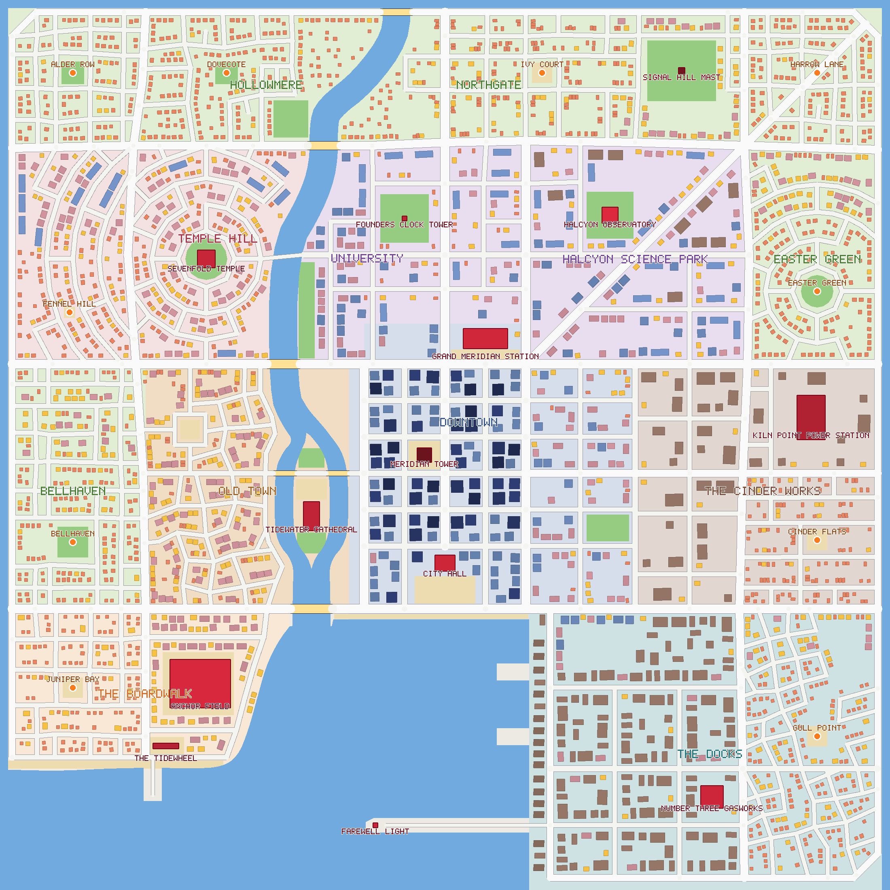

# Port Meridian

Port Meridian is the one city of Monster Battle 9001. This document is for the owner (a tour and
the reasons behind the layout) and for the building artists who model it next (every district,
every landmark and every ordinary building type, described so it can be modeled without asking).

Status: **the game plays in Port Meridian** (since 12 November): the server, the client, the
sandbox, the bots and the balance harness all build it through `getCity()`. The placeholder grid
city is kept for tests and as a development option. Section 9 says what the switch did; the
client's part (district tint, draw-call count) was done on 12 November (section 8).

Pictures in `docs/city/` (all drawn by `npx tsx shared/scripts/cityMap.ts --city meridian`;
north is up, east is to the right, exactly like the in-game map):

| Picture | What it shows |
|---|---|
| `map.png` | The whole city, colored by district, buildings shaded by height, landmarks in red, starting neighborhoods as orange dots. |
| `roads.png` | The street network the army's vehicles drive on, with bridges and the ford. |
| `heat.png` | Where the value is: the brighter, the more points a kaiju earns by wrecking it. |
| `anchors.png`, `anchor_<name>.png` | For each starting neighborhood, the stage 1 square (blue) and stage 2 square (orange), with the value inside each. |
| `district_<name>.png` | A close-up of each district at 1 meter per pixel. |
| `model.png`, `model_downtown.png` | An "architect's model": every building as an extruded box, seen from the south-west. |

The model pictures are drawn by the same script (a small box renderer written for it), not by the
Blender tools under `tools/art/lib`: that was faster to iterate on and needs no 3D software.

---

## 1. A short tour

Port Meridian is a harbor city about 2.1 km across, built on a square of land with the sea to the
south. A wide bay is cut into the south coast. The **River Wend** comes down from the north edge,
bends past Temple Hill, splits around **Chapter Island** (where the cathedral stands) and reaches
the bay between the Old Town on the west bank and the downtown towers on the east bank.

- In the middle stands **Downtown**: a regular grid of glass towers around **Meridian Tower**, the
  tallest building in the city (220 m), with **City Hall** on Founders Plaza at the waterfront and
  **Grand Meridian Station** at the north end.
- Around downtown lie the mid-rise quarters: the crooked **Old Town** across the river, the
  **University** and the **Halcyon Science Park** to the north, **The Cinder Works** (industry and
  the power station) to the east, **The Docks** along the east side of the bay, and **The
  Boardwalk** (stadium, ferris wheel, beach) on the west side of the bay.
- Along the west, north and east edges lie the low-rise neighborhoods where a match starts:
  **Bellhaven**, **Temple Hill** (terraces on a round hill around a temple), **Hollowmere**,
  **Northgate** and **Easter Green**.
- A **beltway** runs all the way round the city edge. It is where army squads arrive in the
  last stage. Outside it, along the west, north and east edges, runs the **Old Moat**, where a
  young Gragnor can swim (section 11).

### Why the city is laid out in three bands

The city is a level first. Three distances shape it:

- **The core.** The towers stand within about 200 m of the center, inside the ring boulevard
  (River Drive, East Ring, Kingsway and the core streets). Every starting neighborhood is 920 m
  from the center, so its stage 2 square (which slides toward downtown) stops at the ring
  boulevard. A juvenile kaiju never gets the towers; they are the titan's prize.
- **The frame.** Avenues at 740 m from the center separate the starting neighborhoods from the
  mid-rise ring. Inside every stage 2 square there is a dense mid-rise "inner ring" quarter
  in the corner nearest downtown, which draws the juvenile toward the towers.
- **The edge.** The beltway at 1070 m is where squads deploy at stage 3.

---

## 2. The districts

Colors are the map tint. So that a district is recognizable from a kaiju's eye as well as on the
map, every district also carries a **building tint** (`District.tint` in the city data, a color
the client multiplies each building's color by: one color per building instance, no extra draw
calls). Each ordinary building type has **one** model for the whole city, made in light, neutral
colors (pale stone, white render, light grey roofs, plain glass); the tint gives it the district's
color family. A white model shows the tint exactly; a dark one hardly changes.

| District | Building tint | Effect on a white wall |
|---|---|---|
| Downtown | `#d8e0ec` | cool blue-grey glass and stone |
| Old Town | `#f4e2c2` | warm sand and ochre |
| Temple Hill | `#f2dad2` | dusty rose plaster |
| Hollowmere, Northgate, Easter Green, Bellhaven | `#f4f2e6`, `#f4f0e4`, `#f6f2e6`, `#f6efe4` | almost white: the pastel suburbs keep their own mixed colors |
| University | `#f0d2c4` | red-brick warmth |
| Halcyon Science Park | `#eef2f6` | clean white and glass |
| The Cinder Works | `#dccec2` | soot brown-grey |
| The Docks | `#d6dee2` | harbor blue-grey |
| The Boardwalk | `#fcf6ee` | whitewash |

The client applies it (`client/src/render/cityView.ts`): a building's wall faces (those its
model masks for paint, `docs/art/client-notes-city.md` section 2) take one of the colors its
model offers, picked by the structure's id, times the tint of the district its center is in.
Roofs, glass, signs and doors keep the art's colors. Landmarks are one-offs and are modeled in
their final colors; the tint is for ordinary buildings only.

| District | Map tint | Street pattern | Buildings | Structures | Value |
|---|---|---|---|---|---|
| Downtown | slate blue | regular grid | towers, offices, big apartments | 183 | 42 104 |
| Old Town | warm sand | crooked, irregular | row houses, shops, small apartment blocks | 202 | 7 972 |
| Temple Hill | dusty rose | rings and spokes round the temple | houses, shrines, cloister halls | 322 | 8 426 |
| Hollowmere | pale green | curving suburban streets | detached houses | 285 | 2 349 |
| Northgate | pale green | grid with a diagonal avenue | houses, row houses, the television mast | 372 | 5 394 |
| Easter Green | pale green | garden suburb round a green | houses, a few apartments | 177 | 2 844 |
| Bellhaven | pale green | small grid | houses, high street shops | 195 | 2 645 |
| University | lavender | quads | lecture halls, row houses, clock tower | 103 | 7 331 |
| Halcyon Science Park | lavender | grid cut by the diagonal Harrow Road | offices, labs, observatory | 114 | 8 882 |
| The Cinder Works | warm grey-brown | big lots | factories, tanks, power station, workers' rows | 169 | 5 362 |
| The Docks | blue-grey | big lots and a crooked fishing quarter | cranes, containers, warehouses, gasworks | 388 | 11 664 |
| The Boardwalk | peach | small grid and a seafront strip | pavilions, hotels, stadium, ferris wheel | 187 | 5 693 |

(Structures and value counted inside each district polygon. Totals: 2695 structures worth
110 896 points. The Farewell Light stands on the harbor mole, outside every district.)

**Downtown.** The prize of stage 3. A tight grid of 14 m streets between the 22 m ring avenues,
blocks filled edge to edge with offices and towers (12 to 165 m), Meridian Tower in the middle
next to Exchange Square. Founders Plaza and City Hall face the bay; the Embankment Promenade runs
along the waterfront; Station Square and Grand Meridian Station close the north end. Long straight
avenues give the army volleys and crossfire; the towers block sight lines in between. Glass and
steel, blue-grey with pale stone at the base.

**Old Town.** The west bank opposite downtown. Crooked lanes, small blocks, row houses and shops
three to five stories high, with Market Square (a looped street round a plaza) in the middle and
the Cathedral Close by the river. Warm stone, ochre plaster, red tile roofs. For the juvenile: a
dense, tramplable feast; for the squads, tight quarters with short sight lines.

**Temple Hill.** A round hill north-west of Old Town, built in terraces: ring streets and spokes
around the Temple Gardens and the Sevenfold Temple on top, with small tiered shrines along the
rings and long cloister halls on the outer terraces. Pale plaster, terracotta, rose. Two starting
neighborhoods (Fennel Hill on the west slope, and the Pilgrims Rise high street) lie here. Tanners
Ford, the one marked ford over the river, leads from the hill to the University.

**Hollowmere, Northgate, Easter Green, Bellhaven (the suburbs).** The hatchling's pantry: detached
houses with yards (to hide in), corner shops, parked cars, small greens and plazas (open spots
where squads can catch a hatchling). Hollowmere has curving streets and cul-de-sacs; Northgate is a
plain grid crossed by Harrow Road, with Signal Hill and its mast; Easter Green is a garden suburb
in rings round a round green; Bellhaven is a small grid with a high street. Pastel walls, grey and
red roofs, lots of trees.

**University and Halcyon Science Park.** North of downtown. Quads of long lecture halls round
Scholars Quad and the Founders Clock Tower; then the science park, a grid of mid-rise offices and
labs cut diagonally by Harrow Road, with the Halcyon Observatory on its green hill. Red brick and
pale stone at the university, white and glass in the science park.

**The Cinder Works.** East of downtown. Big lots: sawtooth factories, warehouses, round storage
tanks, and the Kiln Point Power Station with its chimneys at the east edge; workers' row houses
around Cinder Flats in the south-east. Soot brown, rust, grey concrete. The big lots look sparse
on the map (one to five buildings on a 100 x 130 m block): that is deliberate. Their yards must
stay open (section 10: no yard may trap a squad, and buildings a juvenile cannot trample keep
19.5 m apart), and a trial that packed them with container stacks lost almost all of them again
to the yard opener. In 3D the sheds, tanks and chimneys still read as heavy industry.

**The Docks.** The east shore of the bay. A row of gantry cranes along the quay, container stacks,
warehouses, the Number Three Gasworks, and a crooked fishing quarter of small houses around Gull
Point. The Long Mole runs west from the docks into the bay to the Farewell Light. Blue-grey,
rust red, container colors (orange, teal, red).

**The Boardwalk.** The west shore of the bay. Seafront hotels, striped pavilions along Juniper
Strand (the beach), Wheel Plaza with The Tidewheel, a pier, and Anchor Field (the stadium) behind
the Stadium Concourse. Whitewash, candy stripes, sea blue.

---

## 3. The landmarks

Every landmark is its own archetype (one model file `lm_<id>.glb`), with its own name. Positions
are in meters from the city center (east, north). Footprint is width x depth at ground level;
"faces" is the side its front looks to. Landmarks over 70 m (the wheel, the power station, the
mast, Meridian Tower) cannot be trampled even by the titan; the rest fall to its feet. All names
are invented; nothing copies a real place, building, brand or faith.

Damage, for every landmark: the game shows three states (intact, damaged, rubble). Damaged means
broken windows, a missing corner or top, scorch marks and something bent; rubble is a low heap in
the landmark's colors with one recognizable piece sticking out (named below), so players can still
tell what it was.

| Landmark | id | District | Position (E, N) | Footprint | Height | Hit points | Value |
|---|---|---|---|---|---|---|---|
| Meridian Tower | `meridian_tower` | Downtown | -51, -25 | 36 x 36 | 220 | 12 000 | 1 500 |
| City Hall | `city_hall` | Downtown | 0, -292 | 50 x 40 | 45 | 5 000 | 900 |
| Tidewater Cathedral | `tidewater_cathedral` | Old Town (Chapter Island) | -330, -176 | 40 x 72 | 58 | 6 000 | 900 |
| Anchor Field | `anchor_field` | The Boardwalk | -605, -590 | 150 x 120 | 30 | 14 000 | 1 200 |
| The Tidewheel | `tidewheel` | The Boardwalk | -690, -744 | 64 x 14 | 76 | 2 500 | 500 |
| Halcyon Observatory | `halcyon_observatory` | Halcyon Science Park | 408, 568 | 40 x 40 | 24 | 3 000 | 500 |
| Farewell Light | `farewell_light` | the harbor mole | -172, -940 | 12 x 12 | 48 | 1 500 | 350 |
| Kiln Point Power Station | `kiln_point_power` | The Cinder Works | 905, 68 | 110 x 70 | 82 | 12 000 | 1 300 |
| Sevenfold Temple | `sevenfold_temple` | Temple Hill | -590, 460 | 44 x 44 | 52 | 4 000 | 700 |
| Grand Meridian Station | `grand_station` | Downtown | 100, 263 | 110 x 50 | 40 | 7 000 | 900 |
| Signal Hill Mast | `signal_mast` | Northgate | 585, 925 | 16 x 16 | 160 | 3 000 | 500 |
| Number Three Gasworks | `gasworks` | The Docks | 660, -870 | 56 x 56 | 44 | 4 000 | 600 |
| Founders Clock Tower | `founders_clock` | University | -100, 560 | 12 x 12 | 62 | 2 000 | 400 |
| Grand Harbor Bridge | `bridge_b` (bridge) | river mouth | -330, -405 | 22 x 110 | 36 | 4 000 | 400 |

**Meridian Tower** (faces south). The city's compass needle, seen from everywhere. A square
glass shaft that steps in three times as it rises (setbacks at about 80, 140 and 190 m), crowned
by an open steel lantern and a slim spire. Blue-green glass with bright white vertical fins at the
corners; a gold band at each setback that catches the light. A two-story stone podium with a
deep entrance canopy on the south side. Damaged: the spire bent over, a setback broken open with
floors showing. Rubble: the lantern lying on the heap.

**City Hall** (faces south onto Founders Plaza). A wide neoclassical block of pale limestone,
three stories, with a portico of eight columns and a broad flight of steps, carrying a tall
ribbed copper dome (weathered green) on a drum ringed by small columns, topped with a lantern and
flagpole. Two short wings. Damaged: dome caved in on one side, columns snapped. Rubble: the
green dome shell, cracked, on top.

**Tidewater Cathedral** (faces north, on Chapter Island). Long and narrow (72 m), dark grey
stone with a steep slate roof, one tall square bell tower at the north end with a pointed spire,
flying buttresses along both sides and a big round window over the north door. Rows of tall
narrow windows with blue glass. Fictional and of no particular faith: no symbols on the roof or
spire beyond a plain finial. Damaged: spire snapped, buttresses broken off. Rubble: the round
window frame standing upright.

**Anchor Field** (faces north). The stadium. An oval bowl of white concrete tiers with four
tall floodlight masts at the corners and a cantilevered roof over the west stand, bright green
pitch inside, the outer wall banded in sea blue. Damaged: a stand collapsed inward, one mast down.
Rubble: a broken ring with the green pitch still showing.

**The Tidewheel** (faces south, onto the beach). A giant ferris wheel, 76 m, on two A-frame legs,
with about 24 candy-striped gondolas (red, white, sea blue) and a ring of bulbs. A small ticket
pavilion at its foot. The footprint is long and thin (64 x 14): the wheel's face runs east-west,
so from the beach and the sea you see the whole round wheel. Damaged: wheel tilted and buckled, gondolas hanging. Rubble: the wheel on its side,
half rolled.

**Halcyon Observatory** (faces south, on Halcyon Hill). Low and wide: a round white drum with a
big silver dome split by an open shutter slot, a telescope tube poking out, and two smaller
domes on a terrace. Damaged: the big dome cracked open like an egg. Rubble: the telescope tube
pointing at the sky.

**Farewell Light** (faces north, at the end of the Long Mole). A lighthouse, 48 m: a round
tapering tower with red and white bands, a black gallery and a glass lamp room on top, on a
square stone base. Damaged: lamp room smashed, top leaning. Rubble: the red-and-white stump.

**Kiln Point Power Station** (faces west). A huge brick turbine hall with tall arched windows,
four square chimneys rising to 82 m at the corners, a boiler house and a row of transformers.
Dark red-brown brick, black soot streaks on the chimneys. Damaged: a chimney snapped mid-height,
roof holed with steam. Rubble: two chimneys still standing out of the heap.

**Sevenfold Temple** (faces east, at the top of Temple Hill). Seven round drums stacked on a
broad square stone platform with stairs on all four sides, each drum narrower than the one below
and each capped by a flat, wide brim roof (like a stack of hat brims), terracotta and cream, with
thick ropes hung with big bronze bells looping between the brims. Clearly invented: no upturned
eaves, no pagoda or real temple shape, and no symbols. Damaged: top three drums gone, bells
hanging loose. Rubble: the lowest brim on the platform with a bell beside it.

**Grand Meridian Station** (faces south onto Station Square). A long hall of iron and glass: a
barrel-vaulted train shed behind a stone front with a big round clock window over the entrance
and two short towers at the ends. Cream stone, green ironwork, glass roof. Damaged: vault
collapsed in the middle. Rubble: the clock face on the heap.

**Signal Hill Mast** (on Signal Hill). The television mast: 160 m, a slim red-and-white lattice
tower with dishes at two heights, a small equipment house at the foot, blinking lights at the
top. The north side of the city's sky line. Damaged: top third folded over. Rubble: a long bent
lattice lying across the park.

**Number Three Gasworks** (faces west). Two round gas holders in tall green iron frames (columns
and rings), one full and high, one half sunk, next to a brick retort house. Damaged: a frame
twisted, the holder deflated. Rubble: the iron rings.

**Founders Clock Tower** (faces south, on Scholars Quad). A slender square red-brick tower,
62 m, with four big white clock faces near the top, a copper pyramid roof and a small lantern.
Damaged: clock faces shattered, roof gone. Rubble: one clock face leaning on the heap.

**Grand Harbor Bridge** (the river mouth). The one tall bridge, a road deck 24 m wide (the 22 m
River Drive plus a curb each side) under two steel truss arches 36 m high, painted rust red, joining Old Town and downtown along the
waterfront. It is a bridge archetype (passable, it carries roads), not a landmark class.
Damaged: one arch broken. Rubble: the deck sagging into the river.

Spread: every part of the city has one in sight. The tall ones (tower, mast, wheel, chimneys,
cathedral spire, clock tower) are visible across the city; each stage 2 square holds at least one
landmark (section 6). On a 25 m grid of dry land inside the beltway, no point is further than
748 m from a landmark (the far north-west corner, near Alder Row).

Every landmark a juvenile can reach (those in some stage 2 square: all but Meridian Tower, City
Hall and the Farewell Light) has a 20 m apron: no building taller than 12 m (one the juvenile
cannot trample) stands within 20 m of it, so the 18 m wide juvenile never wedges itself into a
notch between a landmark and a block of flats.

---

## 4. The ordinary buildings

40 archetypes in total (the cap, see section 8): the 22 the placeholder city already had, and 18
appended for Port Meridian (6 new ordinary types, one new bridge, 11 new landmarks). Size is
width x depth x height in meters. The class decides what the game counts (end-screen tallies).

Rules of thumb for gameplay: houses (5 to 9 m) are the hatchling's food; shops and low blocks
(up to 12 m) get trampled by the juvenile; apartments and offices stop the juvenile; towers above
70 m stop even the titan's trample.

For the artists: one model per id, made in **light, neutral colors** (the district tint in
section 2 adds the color family), with **at most two materials** per model, taken from the shared
ones in `docs/ASSETS.md` (the draw-call budget in section 8 depends on it). Bridge models are
stretched to fit their crossing (section 5): put the piers at the two ends of the deck and make
the middle spans and railings plain and repeating along the length, so a stretch from 57 to
82 m (`bridge_a`) or to 104 m (`bridge_b`) and a little extra width does not look wrong.

| id | Class | Size | Where | Look |
|---|---|---|---|---|
| `house_a` | house | 9 x 10 x 6 | suburbs, Old Town edge | Two-story detached house, pitched gable roof, white render, white trim, light grey slate. |
| `house_b` | house | 11 x 9 x 7 | suburbs, Temple Hill | Wider house with a hipped roof and a porch, pale render, light clay-tile roof (the tint makes it terracotta on Temple Hill). |
| `house_c` | house | 8 x 8 x 5 | suburbs, Boardwalk, Docks | Small cottage, one and a half stories, steep roof, pale clapboard walls, light grey roof. |
| `rowhouse_a` | house | 7 x 11 x 9 | Old Town, University, Cinder Works | Three-story narrow terraced house, flat front with a parapet, light sandstone-colored brick, chimney stack. Placed in rows (the tint turns the rows ochre, brick red or soot brown by district). |
| `shop_a` | shop | 11 x 10 x 5 | suburbs, Boardwalk | One-story corner shop, flat roof, striped awning, big window. |
| `shop_b` | shop | 14 x 11 x 8 | Old Town, Docks, University | Two-story shop with a flat over it, shopfront and awning below, brick above. |
| `shop_c` | shop | 12 x 12 x 10 | Downtown, Old Town | Three-story shop block with a cornice, stone ground floor, sign band. |
| `apartment_a` | apartment | 18 x 14 x 20 | Old Town, suburbs, University | Six-story walk-up, flat roof with water tank, brick, balconies. |
| `apartment_b` | apartment | 16 x 16 x 28 | Old Town, Downtown, Boardwalk | Eight-story block, square, white plaster with balconies and big windows (it reads as a seafront hotel on the Boardwalk). |
| `apartment_c` | apartment | 24 x 14 x 36 | Downtown, Docks | Ten-story slab, long and narrow, concrete with strip windows. |
| `office_a` | office | 20 x 20 x 42 | Downtown, University | Twelve-story office, stone grid facade, flat roof with plant room. |
| `office_b` | office | 24 x 18 x 55 | Downtown | Glass office slab with a setback at the top. |
| `office_c` | office | 22 x 22 x 68 | Downtown | Twenty-story glass and stone office with a crown. |
| `tower_a` | tower | 26 x 26 x 95 | Downtown | Square glass tower, flat top with a mast. |
| `tower_b` | tower | 30 x 30 x 130 | Downtown | Glass tower with chamfered corners and a stepped top. |
| `tower_c` | tower | 28 x 28 x 165 | Downtown | The tallest ordinary tower: dark glass, a slanted roof. |
| `factory_a` | factory | 36 x 24 x 14 | Cinder Works, Docks | Sawtooth-roof factory shed, brick and corrugated metal, one short chimney. |
| `factory_b` | factory | 44 x 30 x 18 | Cinder Works | Big steel hall with a gantry, rusty cladding, roof vents. |
| `warehouse_a` | factory | 30 x 20 x 11 | Cinder Works, Docks | Plain warehouse with a curved roof and loading doors. |
| `bridge_a` | bridge | 16 x 74 x 8 | river crossings | Ordinary road bridge: concrete deck on piers at both ends, railings, lamps. Passable. Stretched to each crossing: 16 to 24 m wide, 57.5 to 81.5 m long. |
| `tank_a` *(new)* | factory | 18 x 18 x 14 | Cinder Works, Docks | Round storage tank, white or silver, with a spiral stair and a ring walkway. |
| `crane_a` *(new)* | factory | 16 x 26 x 46 | Docks quay | Gantry crane on four legs straddling the quay edge, boom raised, harbor red or yellow. |
| `container_a` *(new)* | factory | 13 x 26 x 8 | Docks, Cinder Works | A stack of shipping containers three high in mixed colors. The one low industrial piece (a juvenile walks through it), so it is cheap. |
| `campus_a` *(new)* | office | 44 x 16 x 16 | University, Temple Hill | Long hall with a pitched roof, tall windows above a ground-floor arcade, pale stone walls, light slate roof (lecture hall at the university, pilgrim hall on Temple Hill: the tint does the rest). |
| `pavilion_a` *(new)* | shop | 16 x 12 x 7 | Boardwalk | Striped seaside pavilion (arcade, bandstand, bathhouse) with a canvas roof and flags. |
| `shrine_a` *(new)* | shop | 10 x 10 x 11 | Temple Hill, Old Town | Small wayside shrine in the Sevenfold Temple's invented style: three stacked round drums with flat brim roofs and one bronze bell on a rope, cream and terracotta, no symbols, no upturned eaves. |
| `bridge_b` *(new)* | bridge | 22 x 110 x 36 | river mouth | The Grand Harbor Bridge (section 3). Placed 24 x 103.5 m. |

Ids are append-only: never rename or reorder. Art files are named after them.

---

## 5. Streets, water and crossings

- **Streets**: 636 junctions and 984 street pieces, 75.7 km in all. Arterial avenues (16 to 22 m
  wide) are drawn by hand: the Meridian Beltway round the edge, Kingsway north-south through the
  center, River Drive and East Ring round downtown, the diagonal Harrow Road, Foundry Street, Quay
  Road, Shore Road, Old Post Road, Ironmongers Road, Northern Avenue and Meridian Avenue. Local
  streets (8 to 14 m) grow inside each district in its own pattern.
- **The river** is shallow: units wade across it anywhere at half speed. Six bridge decks cross it
  (the Northgate bridge at the north edge, two on the Temple Hill / University reach, two either
  side of Chapter Island, and the Grand Harbor Bridge at the mouth), plus **Tanners Ford**, a
  marked road through the water below Temple Hill. Bridges are the fast choke points; wading is
  the slow way round. Every deck is the road's width plus a meter each side (never narrower than
  the bridge model): 18, 24, 24, 22, 16 and 16 m wide, so no vehicle drives off the edge into the
  water.
- **The sea**: the bay, a working harbor along the east side with two piers, the Long Mole out to
  the Farewell Light, the Boardwalk pier and beach on the west side.
- **The Old Moat** (section 11): 20 m of water outside the beltway along the west, north and
  east edges of the city, from the beach round to the south-east corner.
- **Parks and plazas** (27 in all, named on the map): a green or plaza at every starting
  neighborhood, the Temple Gardens, Scholars Quad, Halcyon Hill, Signal Hill, Wend Gardens along
  the river, Founders Plaza, Exchange Square, Station Square, Market Square, the Stadium
  Concourse, Wheel Plaza, the Embankment Promenade along the downtown waterfront and Juniper
  Strand (the beach).
- **Props** (5362): parked and moving cars, taxis, vans, trucks, buses at stops, kiosks on plazas
  and high streets, trees in parks and along avenues, lamps, traffic lights at junctions,
  benches, hydrants and billboards.

---

## 6. The starting neighborhoods (anchors) and fairness

A match starts at one of ten neighborhoods. All lie in low-rise areas 920 m from the center; the
stage 1 square (180 m half-size) holds only houses, shops, cars and kiosks, with yards to hide in
and a green or plaza for squads to catch a hatchling in. The destruction bar marks are fractions
of the value inside these squares, so the value inside them is kept close for every start
(measured with the game's own `stageBounds` and `valueInBounds`):

| Anchor | Position (E, N) | Value in stage 1 square | Value in stage 2 square | Landmarks in the stage 2 square |
|---|---|---|---|---|
| Alder Row | -920, 920 | 1372 | 17 361 | Sevenfold Temple |
| Bellhaven | -920, -240 | 1379 | 18 088 | Tidewater Cathedral |
| Cinder Flats | 920, -235 | 1383 | 18 651 | Kiln Point Power Station |
| Dovecote | -540, 920 | 1384 | 17 942 | Sevenfold Temple, Grand Meridian Station, Founders Clock Tower |
| Easter Green | 920, 380 | 1352 | 18 713 | Kiln Point Power Station |
| Fennel Hill | -928, 328 | 1369 | 19 244 | Tidewater Cathedral, Sevenfold Temple |
| Gull Point | 920, -720 | 1384 | 16 932 | Number Three Gasworks |
| Harrow Lane | 920, 920 | 1397 | 17 268 | Halcyon Observatory, Signal Hill Mast |
| Ivy Court | 240, 920 | 1407 | 18 397 | Halcyon Observatory, Grand Meridian Station, Founders Clock Tower |
| Juniper Bay | -920, -600 | 1380 | 17 163 | Tidewater Cathedral, Anchor Field, The Tidewheel |

Spread: stage 1 within 4% (1352 to 1407), stage 2 within 14% (16 932 to 19 244); the target was
about 25%. No stage 2 square reaches the downtown core.

---

## 7. What was measured

All numbers below were measured on the shared 4-core machine while other work was running
(load average 2.3 to 4.7; another program's headless browser used up to 3.6 cores at times). The
machine was never idle.

**Size**: 2695 structures, 5362 props, 40 archetypes, 13 landmarks plus the landmark bridge,
6 bridge decks, 12 districts, 10 anchors, 27 parks and plazas, and the Old Moat (section 11).

**Same everywhere**: city checksum (seed 9001, the game's seed) 3570529651, full checksum
(`meridianChecksum`, which also covers streets, areas, districts and their tints) 3898350366.
Node 22 and headless Chromium 153 compute exactly the same numbers (an esbuild bundle of the
generator, run in both). For seed 9002 the city checksum is 485795498 and the full checksum
3758613154. (Before the Old Moat, 14 November: 5541 props, checksums 1739170986 and 1876286051;
for seed 9002, 2320056143 and 424900319. The moat changed nothing but the tree belt outside the
beltway, which it replaced.) The placeholder city is unchanged: 1340881825 from both `generateCity()` and
`getCity()`.

**Build time** (generation plus spatial index):
- Warm engine: 41 to 61 ms (best of five; the test asks under 200 ms).
- First, cold build in a fresh Node process: 166 to 212 ms of processor time on the main thread
  (`process.threadCpuUsage`, 12 runs); on the clock 230 to 580 ms on the busy machine, because
  the build waits for a core. The spatial index is 10 to 20 ms of that. The placeholder: 10 to
  13 ms. Chromium: 270 ms on the clock, busy machine. Sharing one raster between the yard
  passes (done) and a one-sweep flood of the open ground (tried, gave the identical city, saved
  nothing measurable, not kept) did not move the cold number: it is the engine compiling about
  4000 lines of generator code the first time, spread across all steps (yard opening about 80 ms,
  street fronts about 45 ms, props about 23 ms, streets about 15 ms, ground about 14 ms).
- So the cold build is **at the 200 ms budget, not reliably under it**. It happens once, when the
  server starts or the page loads (behind the loading screen). `shared/test/meridianCold.test.ts`
  times that first build on its own and fails over 400 ms of main-thread processor time. If the
  budget must hold cold, the next step is to cache: build once on the server and send the client
  the checksum only, or keep a prebuilt city in the client bundle and check it against the
  checksum (a city's JSON is about 1 MB).

**Bot matches** (`npm run sim -- --city meridian --nav`, before the switch; the tuned numbers
since are in `docs/BALANCE.md` section 8):

| Run | Bar fractions | Kaiju wins | Mean length | Stage times (stage 1 / 2 / 3, when completed) | Navigation |
|---|---|---|---|---|---|
| 20 contested, seeds 101-120 | today's 0.13 / 0.088 / 0.35 | 5 of 20 (25%) | 10:12 | 2:13 / 2:02 / 6:16 | units stuck 0.02% (longest 3.2 s), 2 give-ups in 20 matches, at most 4 units on one bridge deck, kaiju stuck 0.08% (longest 10.5 s) |
| 10 unopposed | 0.18 / 0.13 / 0.30 | 10 of 10 | 7:33 | segment filled after 2:02 / 2:11 / 2:57 | no stuck units |
| 30 contested, seeds 401-430 | 0.18 / 0.13 / 0.30 | 22 of 30 (73%) | 9:13 | 2:48 / 2:47 / 3:38 (seeds 411-430) | units stuck 0.04% (longest 7.5 s), 6 give-ups in 20 matches, kaiju stuck 0.34% (longest 8.5 s) |
| Earlier: placeholder, 20 contested | today's | 7 of 20 (35%) | 10:57 | 3:24 / 3:32 / 3:57 | units stuck 0.00% |
| Earlier: placeholder, 10 unopposed | today's | 10 of 10 | 7:35 | segment filled after 2:07 / 2:06 / 3:00 | |

(The `--bar P1,P2,P3` option of the harness tries other fractions for one run without changing
the rules file. Unopposed matches repeat exactly per start, so 10 unopposed runs cover 8 distinct
starts here.)

What this says:
- Bots navigate the city: no stuck squads, no pile-ups at bridges; units wade 6 to 10% of their
  time, which is the river doing its job. A few route give-ups (0.1 to 0.3 per match) appeared in
  these batches; none were seen in the review's 30 matches. Not investigated.
- At today's fractions the kaiju wins too rarely (25%): stages 1 and 2 are short (about 2:05),
  stage 3 is long (6:16), because the titan starts stage 3 about 720 m from downtown and only
  20% of the city's value lies within 200 m of downtown (placeholder: 23%).
- At 0.18 / 0.13 / 0.30 the kaiju wins too often (73% over 30 matches). Unopposed, stage 3 still
  fills in 2:57, against the 100 to 130 s target. The 408 s kaiju freeze the review found at
  seed 419 (a notch between Anchor Field and a block of flats) is gone: the 20 m landmark apron
  (section 3) removed that building, and seed 419 now plays a normal 7:14 match. The kaiju bot
  itself still has no "back out when stuck" rule (section 9).
- So the retune is still open. The likely direction: p1 and p2 between today's and the trial's,
  p3 near 0.27 to 0.28, then batches of 20 contested and 10 unopposed until the win rate settles.

---

## 8. Budget

- **Archetypes**: 40 of 40, every one from its art file, one material each. The client draws one
  instanced batch per archetype, per damage state (intact, damaged, rubble) and per material of
  its model, and only batches that have instances are drawn (`client/src/render/cityView.ts`),
  plus one draw for all falling collapse pieces. One more archetype would cost up to 3 calls.
  **Measured** (12 November, headless Chromium, stage 3 at night, the whole city in view from
  1.7 km up, `window.__mb.renderer.info()`): every building intact 111 draw calls and 360,000
  triangles; a third of each archetype damaged and a third in rubble (all 120 batches drawn)
  with 480 pieces falling, 166 calls and 367,000 triangles. The most seen in a five-page match:
  130 calls and 462,000 triangles. Budget: 350 and 1.5 million.
- **District tint**: free in draw calls (one color per instance, set once at load).
- **Counts**: 2695 structures (allowed 2500 to 3200), 5541 props (4000 to 6000).

---

## 9. How to switch the game over to Port Meridian

**Done**: items 1 to 4, 6 and 7 by the city switch, item 5 by the client on 12 November
(section 8 has the measured draw calls). What the switch did, in short: items 1 and 2
as written (the deploy rule, the kaiju bot, `cache.ts`, which now takes `getCity(seed, kind)`);
item 3 was not needed (no archetype changed); item 4: every test listed passes, none loosened
(the clock-end bug was fixed in the simulation, the nav test's missing sub-unit was a navigation
fault on the new city and was fixed with several others, the molt test searches both cities);
items 6 and 7: the documents are updated and the bar fractions are now 0.18 / 0.125 / 0.31
(`docs/BALANCE.md` section 8 has every batch, and the bot and navigation fixes the new city
needed). The steps as they were planned:

1. **Fix the two bot and spawn problems first** (they show up on this city, and they skew any
   balance numbers taken before they are fixed):
   - *Kaiju bot* (`shared/src/sim` bots): when the kaiju has made no progress for 3 s, back it
     out and choose another target, or smash the building in the way. The city's 20 m landmark
     apron removed the one notch the review found (seed 419, a 408 s freeze), but the city still
     has gaps between tall buildings narrower than a juvenile, so the bot must not depend on the
     city. Add a soak check that fails if the kaiju is stuck for more than 20 s.
   - *Stage 3 deployment* (`shared/src/sim/spawn.ts`): along the south edge the deploy line is
     open sea, and the search for dry ground walks inland to the Long Mole, about 1 km from the
     kaiju (measured from Bellhaven, Cinder Flats and Juniper Bay: one squad leader each on the
     mole at N -954, one unit in the water). Skip a deploy candidate whose dry spot is more than
     about 40 m from its point on the line, or whose nearest street junction is a dead end on the
     mole or a pier, so the squad's sector takes its next point. Add a test that deploys stage 3
     from every start and checks that no squad leader lands more than 40 m inside the line or on
     the mole or the piers.
2. **The one-line change**, in `shared/src/city/cache.ts`: build the city with
   `generatePortMeridian(seed)` (import it from `./meridian/generate`) instead of
   `generateCity(seed)`. `generateCity` itself stays, as the placeholder.
3. **Run `npm run export:defs`** (only needed if archetypes changed since; today
   `tools/art/data/archetypes.json` is in sync).
4. **Tests that assume the placeholder.** A dry run of the whole suite with the city swapped in
   memory (`/tmp/mb-scratch/city-fix/switch/vitest.config.ts`) gave **10 failures in 7 files**
   (the review's earlier dry run gave 11; the extra one, `client/test/session.test.ts`, passed
   this time and looks load-dependent, not city-dependent):
   - `shared/test/meridian.test.ts`: "the placeholder is untouched" expects `getCity()` to be the
     placeholder. Change that half to expect Port Meridian (1739170986); keep the
     `generateCity()` half.
   - `shared/test/city.test.ts`, four tests:
     - "is deterministic, and the seed matters" compares `getCity()` with `generateCity()`
       (not a stored checksum): compare `getCity()` with `generatePortMeridian()` instead.
     - "knows water, parks and bridges" probes a placeholder water spot.
     - "routes across the river over a bridge" and "respects closed edges and reports no route"
       use the placeholder's bridge positions.
     Rewrite the last three against Port Meridian's river and its six bridge decks.
   - `shared/test/flow.test.ts`: squads redeployed at stage 2 came 239.3 m from the kaiju (the
     test asks at least 240). Check `sim/spawn.ts` perimeter points on the new city; probably
     one spawn point or the tolerance.
   - `shared/test/molt.test.ts`: "never leaves a juvenile shaking between walls" fails because
     the test finds no gap of the kind it tries on Port Meridian (it requires at least one).
     Keep it on the placeholder, or let it pass when no such gap exists.
   - `shared/test/nav.test.ts`: "gets every sub-unit to markers dropped anywhere": a sub-unit did
     not arrive at a random marker. **A real issue, not tracked down**: probably a marker dropped
     somewhere the squad cannot reach; check the marker clamping first.
   - `shared/test/prediction.test.ts`: the scripted walk never bumps a wall on the new city;
     move the walk so it does.
   - `shared/test/matchSoak.test.ts`: a match ran 150.033 s against its 150 s clock, exactly one
     tick over (the assertion is that a match never outlasts the clock). That is a clock-end bug
     in the simulation or its report, which the simulation owner must fix; **do not loosen the
     test**. It shows up on this city only because a match happened to end on that tick.
5. **Client** (`client/src/render/cityView.ts`, client owner):
   - Tint each building by its district: once at load, find the district each structure's center
     lies in (point in polygon over `CityData.districts`) and multiply its instance color by
     `District.tint` (absent means white). No extra draw calls.
   - Measure draw calls at stage 3 with buildings in all three damage states
     (`renderer.info.render.calls` in headless Chromium) and write the number in section 8.
6. **Documents that assume the placeholder**: `docs/STATUS.md` (the city section, the bots and
   balance notes), `docs/BALANCE.md` (every measurement and the bar fractions),
   `docs/ARCHITECTURE.md` (the city paragraph names `generateCity`), and this file's status line.
7. **Re-tune** (after item 1): the bar fractions in `shared/src/defs/rules.ts`. Section 7 has the
   numbers: today's fractions give the kaiju 25% of contested matches, the trial 0.18 / 0.13 /
   0.30 gives it 73%, and unopposed stage 3 still takes 2:57 against 100 to 130 s. Try p3 near
   0.27 to 0.28 with p1 and p2 between the two, using `npm run sim -- --city meridian --bar
   P1,P2,P3` (contested, `--seeds 20`, several batches) and `--unopposed --seeds 10`; then write
   the chosen fractions into `rules.ts` and every batch into `docs/BALANCE.md`. The bots' stage 3
   plan (how far the titan walks to downtown) is the next knob if stage 3 stays long.

---

## 10. Where things are (for engineers)

- `shared/src/city/meridian/layout.ts`: the hand-made plan (coast, river, parks, arterial
  streets, landmarks, anchors, districts and their building tints, and the patches that tell the
  generator what to grow).
- `shared/src/city/meridian/*.ts`: the generator (`generate.ts` is the entry,
  `generatePortMeridian(seed)`); `palettes.ts` sets which buildings each patch uses; `build.ts`
  places bridge decks (as wide as their road plus a meter each side), landmarks (with the 20 m
  apron), street fronts and yards, then opens every yard that would trap a squad.
- Tests: `shared/test/meridian.test.ts` (the data, the level, identical on every machine),
  `shared/test/meridianPlay.test.ts` (deployment and bot matches), `shared/test/meridianCold.test.ts`
  (the first build's time).
- `shared/scripts/cityMap.ts`: the pictures. `npm run sim`: the
  balance harness, on this city by default (`--nav` adds the navigation summary, `--bar` tries other bar
  fractions).
- Same on every machine: the generator uses only + - * /, `Math.sqrt`, rounding and the
  project's seeded generator; headings come from a fixed table; every final coordinate
  (structures, props, street junctions, and every point of every water, park, plaza and district
  outline) snaps to 1/8 m. A test scans the generator and the shared files it imports
  (`math/rng`, `city/archetypes`, `city/props`, `city/types`, `defs/stages`, `defs/ids`) for
  forbidden math functions.
- Names: all invented, but a few match real places (Signal Hill, Harrow Road, Kingsway,
  Northgate, Temple Hill), and Bellhaven is close to Belhaven, a Scottish town and beer brand.
  Renaming is the owner's call; if Bellhaven goes, "Bellmere" is a ready replacement (the anchor,
  district, common and high street names are in `layout.ts`; the placeholder city has its own
  Bellhaven anchor in `generateCity.ts`).

---

## 11. The Old Moat (14 November, the swim task)

The owner's note after the second playtest: "Grognar should be able to swim in the river...
We may have to update the map to have water at all stages." The monster can now swim, at
stages 1 and 2 (docs/DESIGN.md section 4, "Swimming"), in water that is deep enough for its body:
0.75 of its body radius from its middle all round at stage 1 (3.6 m of water across), 0.35 at
stage 2 (6.3 m).

**What was missing.** Every starting neighborhood lies 920 m from the center, against the
city's edge, and no stage 1 square held any water at all. Of the stage 2 squares, the six on the
west and north reach the river or the bay; Easter Green and Harrow Lane on the east reach no
water, and Cinder Flats and Gull Point only a 28 m sliver of the bay's quay.

**What changed.** One thing: the Old Moat, three water rectangles in `layout.ts` (`MOATS`), 20 m
wide, between the beltway and the city limit (from 1080 to 1100 m out) along the west edge from
the beach, the whole north edge past the mouth of the River Wend, and the whole east edge. Every
stage 1 and stage 2 square touches the city limit, so every one now holds some of it. That strip
held nothing but the beltway's tree belt, so no street and no building moved: the structures,
their values, the streets and the bar marks are exactly what they were. The moat areas are added
after all the others, so no other area's id (which seeds its furnishing) changed either. Only
the 179 trees of the belt are gone (5541 props became 5362) and the checksums changed (section
7). The juvenile fits in the moat with its flanks against the banks (6.3 m of the 20); the river
(68 to 96 m wide) and the bay are far roomier.

A first try widened the east side into a 36 m canal by pulling the beltway in by 22 m. That
reshuffled the whole city (the street ids seed the buildings, so 1778 of 2695 buildings moved)
and broke the fairness and deployment checks; it was dropped for the moat as it is.

**Checked** (`shared/test/swim.test.ts`, "Port Meridian has water to swim in at every start"):
for every start, at stage 1 and at stage 2, a walk from where the match starts (through nothing
taller than the kaiju tramples, so without breaking anything) reaches deep enough water inside
the bounds. Measured: at stage 1, between 5 700 and 11 100 square meters of swimmable water
inside every square, first reached 148 to 165 m from the start; at stage 2, between 7 200 (Easter
Green) and 138 000 (Juniper Bay) square meters, all of it reachable. The city tests (fairness,
deployment on every perimeter point, no squad landing in water) pass unchanged; only the two
checksum values were updated. `map.png` and `anchors.png` are redrawn with the moat; the other
pictures in `docs/city/` do not show it.

