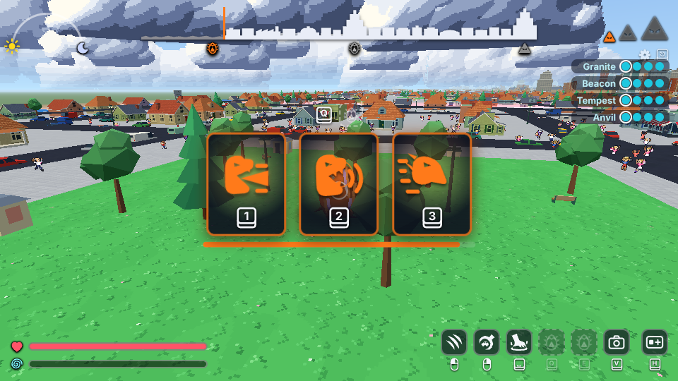
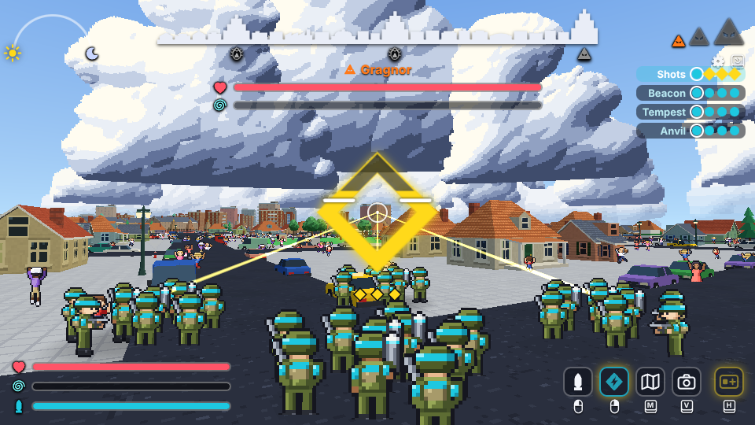
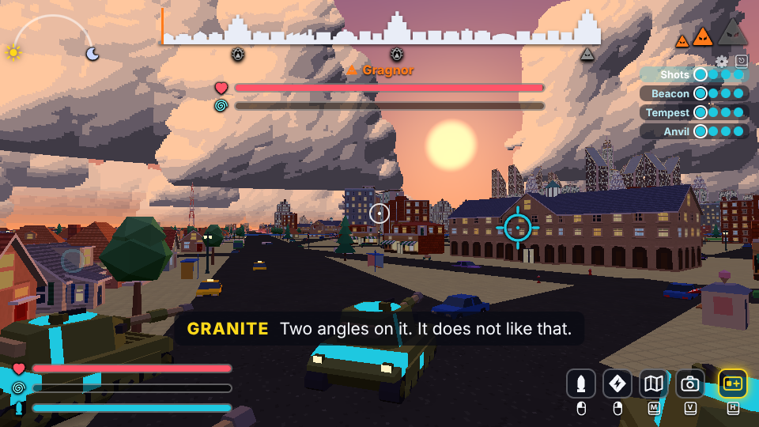

# How to play Monster Battle 9001

## What it is

A giant monster, Gragnor, hatches in the harbour city of Port Meridian and tries to flatten it.
Four army squads try to stop it before the night is over. One player is the monster; the other
four each lead a squad of four units, and the computer fills any empty seat.

A match is three stages, about ten to twelve minutes in all. Every time Gragnor sheds its skin
it grows: from a creature the size of a bus, to one taller than the houses, to one that wades
through skyscrapers. The army grows with it: soldiers with rockets, then tanks, then whole tank
companies.

You need a computer (not a phone or tablet) with a keyboard and mouse, or a game controller,
and an up-to-date Chrome, Edge or Firefox. Nothing to install. Turn the sound on: the radio
chatter tells you what is going on. A voice chat beside the game helps a lot.

## Joining

1. Open the invite link the host sent you. The game loads (a few seconds).
2. The first time, the game shows one box for your name: type it and press Enter (or the arrow
   button beside the box). You are then in the host's room. If you leave the box empty you
   join as "Player 2" (or 3, 4, 5). The game remembers your name, so next time the link takes
   you straight in. To change your name later, click it in the room (it has a frame around it),
   type the new one and press Enter.
3. In the room, the button with the monster or the soldier picks the side you would like.
   Only one person can be the monster; if nobody asks, it takes turns.
4. Press the tick to say you are ready. The host starts the match.
5. A short briefing plays, with your controls on screen. Click the game view once to let it
   take the mouse. Escape gives the mouse back and opens the settings.

## The two sides

**The monster wins** by filling the city skyline at the top of the screen: wreck enough of the
city to reach the third tower before the clock runs out.

**The army wins** by bringing the monster's health to zero, or by holding out until the sun
arc reaches the moon at the end of the night.

Gragnor shrugs off scattered fire. What breaks it is two squads firing **charged volleys** at
it within a few seconds of each other: then it staggers, helpless for five seconds, with its
weak point glowing, and takes four times the damage. That is the army's whole game. (If yours
is the last squad standing, your volleys alone are enough.)

## Controls

Press **H** or **Enter** (or click the left stick on a controller) at any time to open the
controls card; press it again to close it. The game keeps running behind it. Its picture, a card
with its button under it, is always the last picture at the bottom right of the screen, and it
glows for the first 20 seconds of a match.

| What | Keyboard and mouse | Controller |
| --- | --- | --- |
| Move | W A S D, or the arrow keys | Left stick |
| Look and aim | Mouse | Right stick |
| Map | M or Tab | Back (View) |
| Switch the view: from behind (you start there) or through the eyes (you keep looking the same way) | V | Click the right stick |
| Settings | Escape | Start (Menu) |
| Controls card | H or Enter | Click the left stick |

**Monster**

| What | Keyboard and mouse | Controller |
| --- | --- | --- |
| Swipe; with something in your hand, throw it where you aim | Left button | Right trigger |
| Grab; with something in your hand, eat it and heal (one meal every 10 seconds); with nothing to grab but a kiosk or a wreck in reach, eat that | Right button | Left trigger |
| Stomp | Space | Left bumper |
| The move you picked at your first molt (nothing until then) | Q | Y |
| The move you picked at your second molt (nothing until then) | E | Right bumper |
| Shed your skin and grow (one press, when offered) | F | B |
| Pick one of the three cards when you shed your skin (or click the card) | 1, 2, 3 | D-pad left, up, right |
| Swim (stages 1 and 2) | No button: walk into deep water and you go under by yourself. Any monster button brings you up. | The same |

Every button does one thing. Nothing changes when you hold a button down, except the brace.

**Growing, and new moves.** When the skyline reaches a tower, the cocoon picture by F pulses:
press F once to shed your skin. In the cocoon three cards come up in the middle of the screen,
each a new move, with the key that picks it under it. Press 1, 2 or 3, or click a card. It flies
to its button: Q after your first molt, E after your second. A bar under the cards shows how long
you have; if you do not pick in time, one is picked for you.

- First molt: the **beam**, the **roar** or the **charge**.
- Second molt: the two you did not take, and the **brace** or the **tail sweep** (it changes
  from match to match).

| Move | What it does |
| --- | --- |
| Beam | Breathes fire in a straight line where you aim. It needs a full flame meter (your rage, shown once you have the beam). Rage builds from the start of the match, as you wreck and as you are hit, so a beam picked at the first molt can be ready at once. The beam bucks and pulls to one side as it burns: keep steering it back. |
| Roar | Every soldier and tank in reach freezes for two and a half seconds (stars spin over it: it cannot move, fire or charge), then is scared for a few seconds more. |
| Charge | A short wind-up with your head down, then you run straight ahead at twice your walking speed for up to three seconds, slow to turn, smashing small buildings and throwing soldiers aside. You always stumble at the end. Press the button again to stop early. |
| Tail sweep | A quick swing of your tail behind you: it knocks soldiers away and hits the buildings there. |
| Brace | Hold the button to brace: shots from the front do much less. |

**If every squad is wiped out**, the buildings around you start falling by themselves and you
shed your skin straight away. At stage 3 that fills the skyline: you win.

**Squad**

| What | Keyboard and mouse | Controller |
| --- | --- | --- |
| Fire your own gun (keep holding to keep firing) | Left button | Right trigger |
| Volley: hold to make your three other units stop, aim and charge; let go and they all fire where you aim | Right button | Left trigger |
| On foot (stage 1): move | W A S D, relative to where you look | Left stick |
| In a tank (stages 2 and 3): drive forward or back (back is slower) | W, S | Left stick up, down |
| In a tank: turn the tank (it turns on the spot when stopped) | A, D | Left stick left, right |
| In a tank: aim the gun (the turret swings round to where you look, a little slower than you can look) | Mouse | Right stick |
| When your squad is wiped out, as a camera drone: up / down | Space / C | A / B |

Your squad has two buttons and nothing else: no orders to give, nothing to switch. Your three
other units follow you around as a loose group and shoot at the monster by themselves whenever
they can. Your own gun is rockets at first, then a tank gun, then a troop of three tanks.

**The volley.** Hold the right button: your three other units stop where they are, point
yellow laser lines at your crosshair and start to charge. A big yellow diamond fills around your
crosshair. A white notch marks the point where the volley starts to count: let go before it and
the shot is weak; past it the diamond lights up and pulses; at the top it is full (about four and
a half seconds). Let go and they all fire at once, your own shot with them if your gun is
loaded, and the diamond flashes. You can keep driving while they charge. Under the diamond, one
small picture per unit: a yellow diamond while it charges, a cyan circle while it follows you,
red while the monster's roar has frozen or scared it (it cannot charge then).

**Two squads at once.** When another squad's charged volley hits the monster, a ring appears
round your diamond and runs down for five seconds. Land your own charged volley before it runs
out and the monster's nerve can break.

**Driving a tank** (stages 2 and 3). W and S are the throttle and A and D turn the tank, like a
real tank: the keys do not follow your view. The camera stays behind the tank and looks where
you look, and the turret turns toward it at its own pace. Your crosshair shows where you look
(and where a volley goes); a second, cyan sight shows where your gun points right now (and where
your own shot goes). When the turret has caught up, the two sit together. If a house or a wall
stands between your gun and what you are looking at, the cyan sight sits on it: that is what your
shell would hit (the camera is higher than the gun and sees over it). The cyan sight's ring
fills as the gun reloads.

## What the pictures mean

- **Skyline, top centre:** the monster's progress. It fills from the left; the three towers are
  the three stages, and the last one is the monster's win.
- **Arc with a sun and a moon, top left:** the clock. When the sun reaches the moon, the army
  wins.
- **Three triangles, top right:** the monster's size (stage 1, 2 or 3).
- **Names with dots, right:** the four squads. Each dot is a unit still alive; a yellow diamond
  is a unit charging a volley.
- **Bars, bottom left:** heart is health, spiral is nerve (fear), the shell is your reload. Once
  the monster has picked the beam it has a flame there too: its rage, which fires the beam.
- **Big yellow diamond round the crosshair (army):** your volley charging (see "The volley"
  above); a ring round it counting down means another squad's volley just hit: fire yours now.
- **Cyan sight with four ticks (army, in a tank):** where your tank's gun points right now.
- **Colours and shapes:** cyan circles are the army, orange triangles are the monster, yellow
  diamonds are volleys being charged. The orange eye in the middle of the screen means a squad
  leader can see the monster up close. The orange triangle over the monster shows only while a
  squad leader has it in plain sight; it is not there all the time.
- **Spines over two waves, top middle (monster only):** you are swimming under water. Faint
  while you are going down or coming up.
- **Yellow diamonds at the edge of the monster's screen:** squads charging a volley at it, in
  the direction they are (an arrow points at them). They grow as the charge builds, flash fast
  when the volley is nearly ready, and blink white when it is fired.
- **Pictures with a button, bottom right:** what you can do right now and which button does it.
  The monster's two move buttons (Q and E) start as faint eggs and fill at the molts; a ring
  round a move fills as it comes ready again. Yellow stars spinning over soldiers mean the roar
  has frozen them.
- **Subtitles:** what the radio (army) and the television news (monster) say out loud, with
  the speaker's name. The radio calls out what is happening in the fight; the news only breaks
  in for the big moments (the start, a landmark falling, the monster growing, the last minute,
  the end).

## Seven tips for the monster

1. Wreck buildings, not soldiers. Only the skyline wins; chasing tanks wastes the clock.
2. Watch for yellow laser lines, and the yellow diamonds at the edge of your screen: a squad is
   charging a volley. If you have the roar, roar: every soldier and tank inside the orange
   shockwave freezes, loses its charge, and then backs away scared. If you have the brace,
   hold it and face them. Or stomp the squad that is closest.
3. Face the guns. Hits on your back and sides hurt much more than hits on your front.
4. Shed your skin somewhere quiet. For ten seconds you are a helpless cocoon, but when you
   burst out, every squad close by is blown away. Pick your card while you wait.
5. Grab a car and throw it at a squad, or press the right button again to eat it and heal.
   Next to a kiosk or a wreck with nothing to pick up, the right button eats it straight away.
   Save the beam for a row of tall buildings.
6. Charge down a street of small houses: they all come down, and so does any squad in the way.
   Point it before you press: once you are running you turn slowly. A squad sneaking up behind
   you is what the tail sweep is for.
7. Swim. While you are small (stages 1 and 2), walk into the river, the bay or the moat that
   runs round the edge of the city, and stand or walk without pressing anything: after a
   second you sink until only your spines show. You swim faster than you walk, the army has
   to come close to see you, and it can only hit the spines. You cannot attack, grab or burn
   from the water, and you wreck nothing there, so it is for getting away and getting about:
   the clock keeps running for the army. Press any monster button to come up (it takes about
   half a second, then that button does its thing).

## Six tips for the army

1. Pair up. Hold the right button until the yellow diamond is full, then let go at the same
   moment as another squad (say "volley now" on voice chat). Or watch for the ring round your
   diamond: another squad has just hit, and you have five seconds.
2. Come at it from different sides. Its back takes the most damage, and shots from two
   directions shake its nerve faster.
3. When it staggers (it freezes and its weak spot glows), everybody fires everything.
4. Spread out. A roar freezes everyone near it for a moment and then scares them (no firing for
   a few seconds, the volley's charge gone), and a stomp throws squads around.
5. Every miss lands somewhere, and the city is the monster's score. Aim at the monster, not at
   the building behind it. In a tank, wait for the cyan sight to reach your crosshair before you
   fire.
6. A monster in the water shows only a few spines and slips off the map unless someone is
   close. Wait for it on the bank and shoot at the spines. It cannot fight from under the
   water, and every second it hides there is a second off the clock for you.
