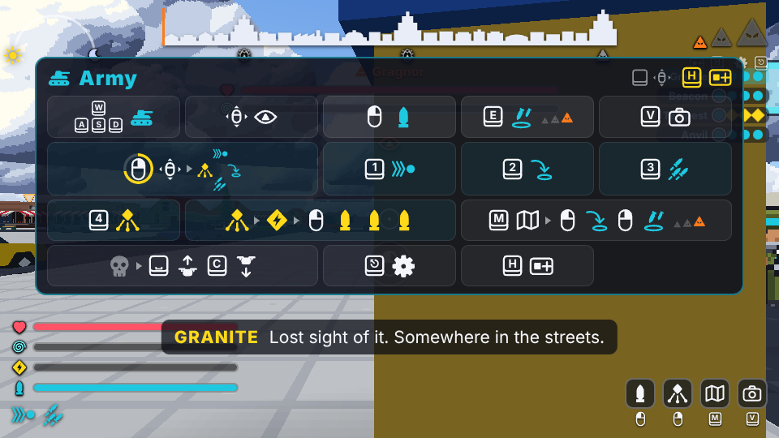
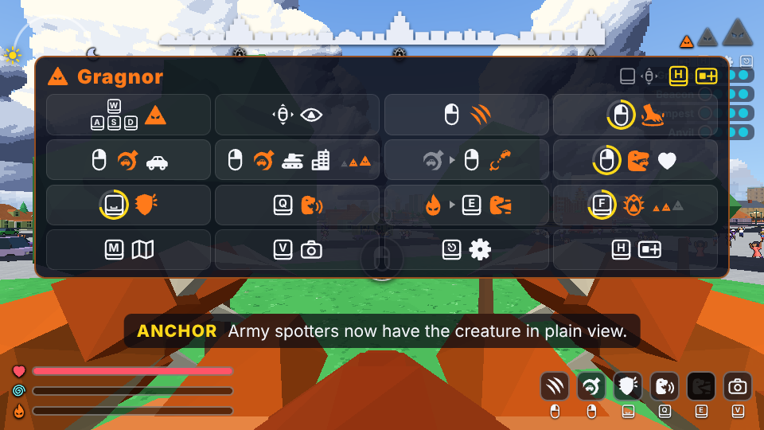
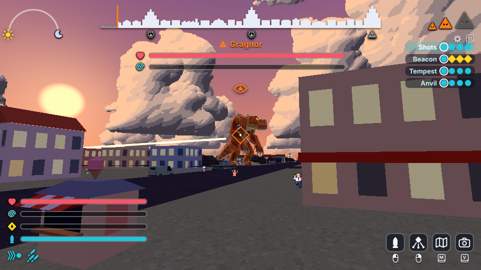

# How to play Monster Battle 9001

## What it is

A giant monster, Gragnor, hatches in the harbour city of Port Meridian and tries to flatten it.
Four army squads try to stop it before the night is over. One player is the monster; the other
four each lead a squad of four units, and the computer fills any empty seat.

A match is three stages, about ten to twelve minutes in all. Every time Gragnor sheds its skin
it grows: from a creature the size of a bus, to one taller than the houses, to one that wades
through skyscrapers. The army grows with it: soldiers with rockets, then tanks, then whole tank
companies with artillery.

You need a computer (not a phone or tablet) with a keyboard and mouse, or a game controller,
and an up-to-date Chrome, Edge or Firefox. Nothing to install. Turn the sound on: the radio
chatter tells you what is going on. A voice chat beside the game helps a lot.

## Joining

1. Open the invite link the host sent you. The game loads (a few seconds).
2. The first time, the game shows one box for your name: type it and press Enter (or the arrow
   button beside the box). You are then in the host's room. If you leave the box empty you
   join as "Player 2" (or 3, 4, 5). The game remembers your name, so next time the link takes
   you straight in. To change your name later, click it in the room (it has a frame around it),
   type the new one and press Enter.
3. In the room, the button with the monster or the soldier picks the side you would like.
   Only one person can be the monster; if nobody asks, it takes turns.
4. Press the tick to say you are ready. The host starts the match.
5. A short briefing plays, with your controls on screen. Click the game view once to let it
   take the mouse. Escape gives the mouse back and opens the settings.

## The two sides

**The monster wins** by filling the city skyline at the top of the screen: wreck enough of the
city to reach the third tower before the clock runs out.

**The army wins** by bringing the monster's health to zero, or by holding out until the sun
arc reaches the moon at the end of the night.

Gragnor shrugs off scattered fire. What breaks it is two squads firing **charged volleys** at
it within a few seconds of each other: then it staggers, helpless for five seconds, with its
weak point glowing, and takes four times the damage. That is the army's whole game. (If yours
is the last squad standing, your volleys alone are enough.)

## Controls

Press **H** or **Enter** (or click the left stick on a controller) at any time to open the
controls card; press it again to close it. The game keeps running behind it. Its picture, a card
with its button under it, is always the last picture at the bottom right of the screen, and it
glows for the first 20 seconds of a match.

| What | Keyboard and mouse | Controller |
| --- | --- | --- |
| Move | W A S D, or the arrow keys | Left stick |
| Look and aim | Mouse | Right stick |
| Map | M or Tab | Back (View) |
| First or third person view (you keep looking the same way) | V | Click the right stick |
| Settings | Escape | Start (Menu) |
| Controls card | H or Enter | Click the left stick |

**Monster**

| What | Keyboard and mouse | Controller |
| --- | --- | --- |
| Swipe (tap), stomp (hold) | Left button | Right trigger |
| Grab (tap), then throw (tap again); eat (hold) | Right button | Left trigger |
| Brace against fire (hold) | Space | Left bumper |
| Roar | Q | Y |
| Fire beam (when the flame meter is full) | E | Right bumper |
| Shed your skin and grow (hold 1 second, when offered) | F | B |

**Squad**

| What | Keyboard and mouse | Controller |
| --- | --- | --- |
| Fire (also sets off your squad's volley) | Left button | Right trigger |
| Command wheel: orders to your three other units (hold, point, let go) | Right button, or Q | Left bumper |
| Follow me / Move to / Fire at will / Hold and charge | 1 / 2 / 3 / 4 | D-pad up / right / down / left |
| Artillery (stage 3 only) | E | X |
| On the open map: move here / artillery here | Left click / right click | A / X |
| When your squad is wiped out, as a camera drone: up / down | Space / C | A / B |

Your squad has one weapon (rockets at first, then a tank gun, then a troop of tanks), always on
Fire; there is nothing to switch. The command wheel is not a weapon picker: its four pictures
are orders for the other three units of your squad (the three blue circles in its middle). The
two orders they are following right now have a blue dot, and when you give a new one the two
small order pictures at the bottom left of the screen pop.

## What the pictures mean

- **Skyline, top centre:** the monster's progress. It fills from the left; the three towers are
  the three stages, and the last one is the monster's win.
- **Arc with a sun and a moon, top left:** the clock. When the sun reaches the moon, the army
  wins.
- **Three triangles, top right:** the monster's size (stage 1, 2 or 3).
- **Names with dots, right:** the four squads. Each dot is a unit still alive; a yellow diamond
  is a unit charging a volley.
- **Bars, bottom left:** heart is health, spiral is nerve (fear), yellow lightning is your
  squad's charge, the shell is your reload. The monster has a flame instead: its rage, which
  fires the beam.
- **Colours and shapes:** cyan circles are the army, orange triangles are the monster, yellow
  diamonds are volleys being charged. The orange eye over the monster means the army can see it.
- **Pictures with a button, bottom right:** what you can do right now and which button does it.
- **Subtitles:** what the radio (army) and the television news (monster) say out loud, with
  the speaker's name. The radio calls out what is happening in the fight; the news only breaks
  in for the big moments (the start, a landmark falling, the monster growing, the last minute,
  the end).

## Five tips for the monster

1. Wreck buildings, not soldiers. Only the skyline wins; chasing tanks wastes the clock.
2. Watch for yellow laser lines: a squad is charging a volley. Roar: every soldier and tank
   inside the orange shockwave flinches, loses its charge, stops firing for a few seconds and
   backs away. Or brace and face them.
3. Face the guns. Hits on your back and sides hurt much more than hits on your front.
4. Shed your skin somewhere quiet. For ten seconds you are a helpless cocoon, but when you
   burst out, every squad close by is blown away.
5. Hold the right button next to a car, a kiosk or a wrecked tank (or with something in your
   hand) to eat it and heal. Throw cars and building chunks
   at squads; save the beam for a row of tall buildings. The beam bucks and pulls to one side
   as it burns: keep steering it back.

## Five tips for the army

1. Pair up. Press 4 (hold and charge), wait until the yellow lightning bar is full, then fire
   at the same moment as another squad. Say "volley now" on voice chat.
2. Come at it from different sides. Its back takes the most damage, and shots from two
   directions shake its nerve faster.
3. When it staggers (it freezes and its weak spot glows), everybody fires everything.
4. Spread out. A roar shakes everyone near it (no firing for a few seconds, charge gone), and
   a stomp throws squads around.
5. Every miss lands somewhere, and the city is the monster's score. Aim at the monster, not at
   the building behind it. At stage 3, use E or the map's right click for artillery.
