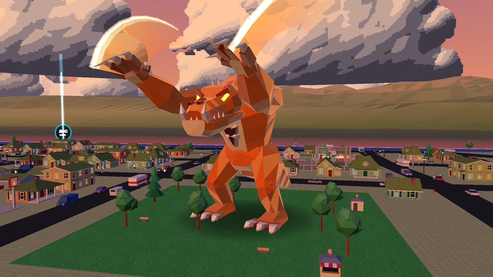
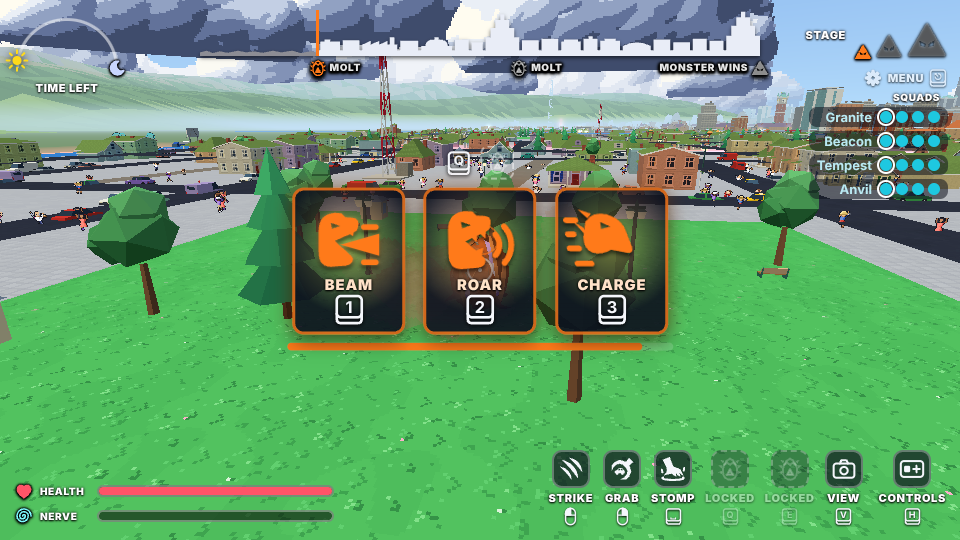
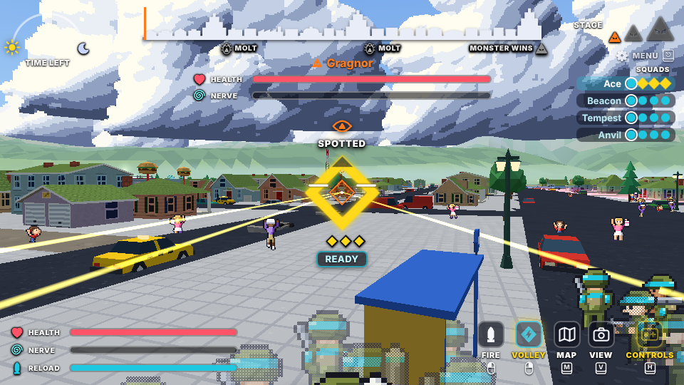
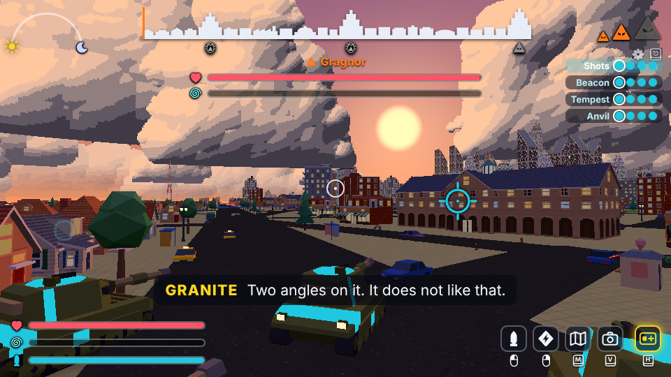
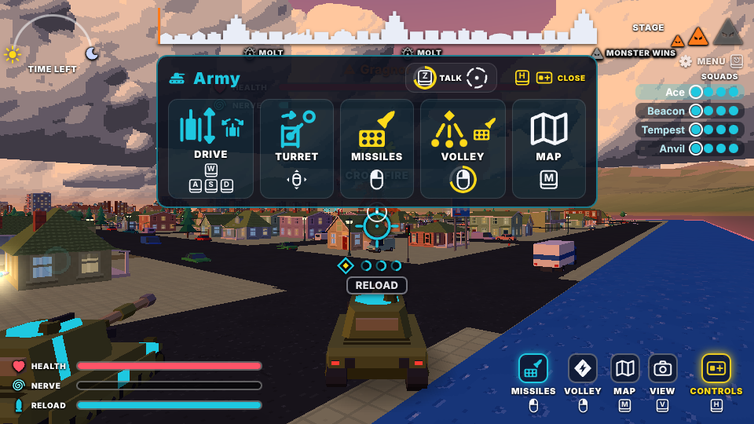
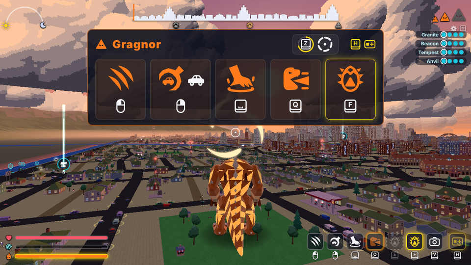
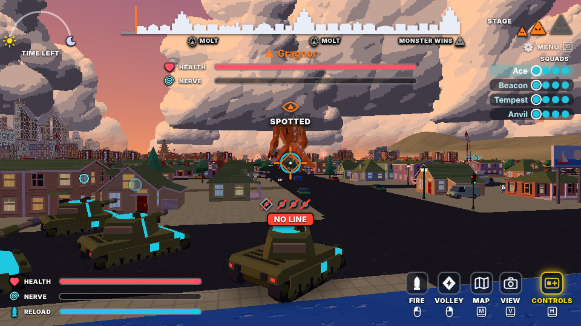

# How to play Monster Battle 9001

## What it is

A giant monster, Gragnor, hatches in the harbour city of Port Meridian and tries to flatten it.
Four army squads try to stop it before the night is over. One player is the monster; the other
four each lead a squad of four units, and the computer fills any empty seat.

A match is three stages, about eight minutes in all (ten at most). Every time Gragnor sheds
its skin it grows: from a creature the size of a bus, to one taller than the houses, to one that
wades through skyscrapers. The army grows with it: soldiers with rockets, then tanks, then whole
tank companies.

You need a computer (not a phone or tablet) with a keyboard and mouse, or a game controller,
and an up-to-date Chrome, Edge or Firefox. Nothing to install. Turn the sound on. A voice chat
beside the game helps a lot: the game has none of its own, only the communication rose (below).
The music gets faster with each stage, and when one minute is left on the clock an alarm sounds
and the music races to the end of the match.

## Joining

1. Open the invite link the host sent you. The game loads (a few seconds).
2. The first time, the game shows one box for your name: type it and press Enter (or the arrow
   button beside the box). You are then in the host's room. If you leave the box empty you
   join as "Player 2" (or 3, 4, 5). The game remembers your name, so next time the link takes
   you straight in. To change your name later, click it in the room (it has a frame around it),
   type the new one and press Enter.
3. In the room, the button with the monster or the soldier picks the side you would like.
   Only one person can be the monster; if nobody asks, it takes turns.
4. Press the tick to say you are ready. The host starts the match.
5. A short briefing plays, with your controls on screen. Click the game view once to let it
   take the mouse. Escape gives the mouse back and opens the settings.

## The two sides

**The monster wins** by filling the city skyline at the top of the screen: wreck enough of the
city to reach the third tower before the clock runs out.

**The army wins** by bringing the monster's health to zero, or by holding out until the sun
arc reaches the moon at the end of the night.

Gragnor shrugs off scattered fire. What breaks it is two squads firing **charged volleys** at
it within a few seconds of each other: then it staggers, helpless for five seconds, with its
weak point glowing, and takes four times the damage. That is the army's whole game. (If yours
is the last squad standing, your volleys alone are enough.)

## Controls

Press **H** or **Enter** (or click the left stick on a controller) at any time to open the
controls card; press it again to close it. The game keeps running behind it. Its picture, a card
with its button under it, is always the last picture at the bottom right of the screen, and it
glows for the first 20 seconds of a match. The card shows only what you can do right now, as
five big pictures at most, each over its button: as the monster, the moves you picked at your
molts appear once you have them, the molt lights up while it is on offer, and what you hold
changes what your two mouse buttons show; as a squad, the tank's driving replaces walking at
stage 2, and a crate's weapon shows on both your buttons. The communication rose's key sits
small at the top of the card.

| What | Keyboard and mouse | Controller |
| --- | --- | --- |
| Move | W A S D, or the arrow keys | Left stick |
| Look and aim | Mouse | Right stick |
| Map | M or Tab | Back (View) |
| Switch the view: from behind (you start there) or through the eyes (you keep looking the same way) | V | Click the right stick |
| Settings | Escape | Start (Menu) |
| Controls card | H or Enter | Click the left stick |
| Say something (the communication rose): hold, move the mouse to a picture, let go | Hold Z | Hold the d-pad down, pick with the right stick |

**The communication rose.** Hold **Z** and a ring of pictures opens around your crosshair. Move
the mouse toward one (the view holds still meanwhile; you can keep moving and shooting) and let
go: your character says something of that kind, and everybody hears it. Let go in the middle to
say nothing. It changes nothing in the game; it is just talk. One every two seconds: while you
wait, the ring is greyed and the wait runs round its middle.

- **Army** (shouted over the radio in your squad's own voice, with your name and the words as a
  subtitle; clockwise from the top): a panicked face (panic), a thumb up (bravado), a megaphone
  (orders), a bubbling flask (somebody call the professor), a house with a heart (home: "my
  mother lives on this street"), a steaming pie (food), a soldier running off (retreat), a face
  with hearts for eyes (admiring the monster).
- **Monster** (no words, no subtitle; the noise comes from you, at your size): the big roar, the
  short roar, snuffles, a growl, a chomp, a contented rumble, and a little musical mating call.

**Restart.** The room's host finds a circular arrow in the settings panel (Escape) during a match
and on the end screen. Press it once (it turns red and pulses), then again within four seconds:
the match starts over for everyone, with the same people on the same sides.

**Monster**

| What | Keyboard and mouse | Controller |
| --- | --- | --- |
| Swipe; with something in your hand, throw it where you aim (a fast-food sign is swung instead) | Left button | Right trigger |
| Grab; with something in your hand, eat it and heal (one meal every 10 seconds), or drop it if it is one of the city's weapons (below); with nothing to grab but a kiosk or a wreck in reach, eat that | Right button | Left trigger |
| Stomp | Space | Left bumper |
| The move you picked at your first molt (nothing until then) | Q | Y |
| The move you picked at your second molt (nothing until then) | E | Right bumper |
| Shed your skin and grow (one press, when offered) | F | B |
| Pick one of the three cards when you shed your skin (or click the card) | 1, 2, 3 | D-pad left, up, right |
| Swim (stages 1 and 2) | No button: walk into deep water and you go under by yourself. Any monster button brings you up. | The same |

Every button does one thing. Nothing changes when you hold a button down, except the brace.

**Throwing.** With something in your hand, a yellow arc on your screen shows where it will fly:
a bright line from your hand, a widening tube round it, and a ring where it can land. Throws
are real tosses: they leave your hand a little above where you look, rise and fall, and land
somewhere inside the ring (never exactly in the middle twice), so a squad standing still about
five of your own lengths away is hit most of the time, and farther away less often. Look higher
to throw farther, or to lob it over a building onto whoever hides behind it; a lob is slower
and less accurate. Look lower to throw short and flat. While you hold something the camera
moves over your right shoulder and stops tilting up a little above the horizon, so you can
always see the ring: moving the mouse up keeps raising the arc. A javelin (an antenna, a radio
mast's top) flies fast and flat and is steadier than a car; a garage door floats like a frisbee.
Things you throw hit the first building, soldier or patch of ground in their way.

**Growing, and new moves.** When the skyline reaches a tower, the cocoon picture by F pulses:
press F once to shed your skin. In the cocoon three cards come up in the middle of the screen,
each a new move, with the key that picks it under it. Press 1, 2 or 3, or click a card. It flies
to its button: Q after your first molt, E after your second. A bar under the cards shows how long
you have; if you do not pick in time, one is picked for you.

- First molt: the **beam**, the **roar** or the **charge**.
- Second molt: the two you did not take, and the **brace** or the **tail sweep** (it changes
  from match to match).

| Move | What it does |
| --- | --- |
| Beam | Breathes fire in a straight line where you aim. It needs a full flame meter (your rage, shown once you have the beam). Rage builds from the start of the match, as you wreck and as you are hit, so a beam picked at the first molt can be ready at once. The beam bucks and pulls to one side as it burns: keep steering it back. |
| Roar | Every soldier and tank in reach freezes for two and a half seconds (stars spin over it: it cannot move, fire or charge), then is scared for a few seconds more. |
| Charge | A short wind-up with your head down, then you run straight ahead at twice your walking speed for up to three seconds, slow to turn, smashing small buildings and throwing soldiers aside. You always stumble at the end. Press the button again to stop early. |
| Tail sweep | A quick swing of your tail behind you: it knocks soldiers away and hits the buildings there. |
| Brace | Hold the button to brace: shots from the front do much less. |

**If every squad is wiped out**, the buildings around you start falling by themselves and you
shed your skin straight away. At stage 3 that fills the skyline: you win.

**The city as a weapon (while you are small).** Around the houses and shops where you hatch
stand things you can pick up with the right button and use with the left one. You can only lift
them at the first size; later you just tread on them. They are never eaten: the right button
drops one again, and it lies there to be picked up later. The pictures over your buttons change
to show what the left and right buttons will do with what you hold.

**What you can pick up glows** (on your screen only): every car and wreck, every one of the
city's weapons while you are small enough to lift it, and a fallen radio mast's top, has a soft
gold glow and a gold ring on the ground round it. Within reach of your hand, where you are
looking, it glows brighter and pulses; the one a grab would take shines brightest. Nothing
glows while your hand is full.

| You hold | The left button | What happens |
| --- | --- | --- |
| Propane tank | throws it | It blows up where it lands. Careful: if a shot lands right by your hand while you hold it, it goes off in your claw, hurts you and makes you flinch. Your left button's picture throbs red while you hold one. |
| Water tank | throws it | It bursts in a big splash that knocks the soldiers in it flat for a moment. |
| Television antenna | throws it like a javelin | It flies fast and nearly flat along your arc, through up to three groups of soldiers, and sticks in whatever stops it. |
| Fast-food sign | swings it like a club | Three big swings, each a wide sweep in front of you with a trail of light. Three dots under the button show the swings left; after the third the sign breaks. |
| Garage door | throws it like a frisbee | While you hold it, it is a shield: shots from in front of you hit the door instead of you (sparks fly off it). A bar by your buttons shows how much it can still take; when it runs out the door breaks apart. |
| The top of a radio mast (left lying when a mast falls) | throws it like a heavy javelin | Like the antenna, but heavier: it goes through up to five groups of soldiers. Unlike the rest, you can pick this one up at every size. |

**The power surge.** Wreck a power substation and you are supercharged for eight seconds:
every button snaps full with a white crackle (all your moves are ready at once), a big blue
lightning badge pops up beside your crosshair with a white ring round it that runs down until
the surge is over, the edges of your screen crackle blue-white, lightning jumps over your back
and tail, and every hit you land flashes electric. Meanwhile your moves come back three times as
fast and every hit lands harder.

**How your attacks look.** Each attack comes in two or three versions, picked for you, that
look different and do exactly the same: a swipe with the right claw, the left claw or both
claws raking down; a stomp with either foot or a hop that lands on both; the tail swept either
way round; a throw overhand or from the side; a roar with the head thrown up or thrust low;
three ways to stumble at the end of a charge; three swings of the fast-food sign. The start of
each attack always looks like that attack, so the army can still read what is coming. Bright
arcs follow your claws and your tail through a strike, and a stomping foot lands with a flash.

**Your rage round your crosshair.** Three claw marks swirl round your crosshair. They heat up
with your rage, one after the other clockwise from the bottom: a dark scar, then ember red,
orange and white-hot when your rage is full. Once you have the beam and it is ready, they throb
and shed little embers: breathe it now. When one of your blows lands, three claw slashes flash
over your crosshair (blue-white in a power surge), and when you burst out of the cocoon in a
new body a hot ring bursts out from the middle of the screen. While you hold something to
throw, the claw marks fade right down, so the arc of your throw and where it lands stay clear.

**Your stripes glow with your rage:** faint when you are calm, bright when you are full of it.
Once you have the beam and it is ready, they throb slowly, and the army can see it. A power
surge turns them blue-white, and they flare white-hot when you burst out of the cocoon.

**People in the street.** Little people run from you, and some freeze in fright first. Anyone
under your feet, under a stomp, in a charge or under your tail's sweep vanishes in a puff (no
harm is shown). A grab that closes on nothing you can hold, with people in reach, comes up with
a handful of them, and you gulp them down. People change nothing in the game: they do not heal
you and they score nothing. New people arrive out of your sight (round a corner, behind a
house, far off) or fade in gently; nobody you can see disappears except under your feet.

**Squad**

| What | Keyboard and mouse | Controller |
| --- | --- | --- |
| Fire your own gun (keep holding to keep firing) | Left button | Right trigger |
| Volley: hold to make your three other units stop, aim and charge; let go and they all fire where you aim | Right button | Left trigger |
| On foot (stage 1): move | W A S D, relative to where you look | Left stick |
| In a tank (stages 2 and 3): drive forward or back (back is slower) | W, S | Left stick up, down |
| In a tank: turn the tank (it turns on the spot when stopped) | A, D | Left stick left, right |
| In a tank: aim the gun (the turret swings round to where you look, a little slower than you can look) | Mouse | Right stick |
| When your squad is wiped out, as a camera drone: up / down | Space / C | A / B |

Your squad has two buttons and nothing else: no orders to give, nothing to switch. Your three
other units follow you around as a loose group and shoot at the monster by themselves whenever
they can. On foot you fit through the narrow gaps between houses (a couple of meters and up),
and your other units follow you through. Your own gun is rockets at first, then a tank gun, then a troop of three tanks, until
a supply crate gives you something better (below).

**The volley.** Hold the right button: your three other units stop where they are, point
yellow laser lines at your crosshair and start to charge. A big yellow diamond fills around your
crosshair. A white notch marks the point where the volley starts to count: let go before it and
the shot is weak; past it the diamond lights up and pulses; at the top it is full (about four and
a half seconds). Let go and they all fire at once, your own shot with them if your gun is
loaded, and the diamond flashes. You can keep driving while they charge. Under the diamond, one
small picture per unit: a yellow diamond while it charges, a cyan circle while it follows you,
red while the monster's roar has frozen or scared it (it cannot charge then).

**Two squads at once.** When another squad's charged volley hits the monster, a ring appears
round your diamond and runs down for five seconds. Land your own charged volley before it runs
out and the monster's nerve can break.

**Driving a tank** (stages 2 and 3). W and S are the throttle and A and D turn the tank, like a
real tank: the keys do not follow your view. The camera stays behind the tank and looks where
you look, and the turret turns toward it at its own pace. Your crosshair shows where you look
(and where a volley goes); a second, cyan sight shows where your gun points right now (and where
your own shot goes). When the turret has caught up, the two sit together. If a house or a wall
stands between your gun and what you are looking at, the cyan sight sits on it: that is what your
shell would hit (the camera is higher than the gun and sees over it). The cyan sight's ring
fills as the gun reloads.

**Supply crates.** When a stage starts, and every so often after that (about every half minute
in the first stage, two or three times as often in the later ones), army crates come down by
parachute onto the streets near the squads. You can see them from far off: a crate
on the ground sends up a cyan column of light and cyan smoke, and the picture of what is inside
floats over it. They show on your map too. Drive any of your units onto a crate to take it for
your squad (anyone's squad may take any crate). Its picture pops up over your crosshair.

| Crate | What it gives your squad, until the stage ends or your squad is wiped out |
| --- | --- |
| Machine gun | Your own gun fires five times as fast: streams of bright tracers. Each shot does less, but more in all. |
| Big cannon | Slow, very heavy shots: a big flash, a puff of smoke, your tank rocks back, and a big blast where it lands. |
| Missile pod | One press fires six missiles that fan out, trailing smoke, and curve in onto your crosshair. |
| Artillery radio | Your next three charged volleys each call an artillery barrage where they land (see below). |
| Reinforcements | Your lost units come back at once by parachute beside you, and everyone is healed. |

The machine gun, big cannon and missile pod replace your own gun, and your volleys use them
too: with the machine gun every unit lets rip a burst of tracers, with the big cannon each fires
a heavy shell, with the missile pod each sends three missiles curving onto your crosshair.
Between volleys your other units shoot their own guns. While you have one, the picture on your
left button is that weapon.

**Artillery.** With the radio, let go of a charged volley (past the notch) and the radio
crackles: red smoke rises where your volley landed and a red ring closes in on the spot. When the
ring has closed, the shells land: you can see them falling and hear them whistle in, and eight
big explosions cover the ring over two seconds. The radio picture by your right button has a dot
for each barrage left. A volley fired at the empty sky calls nothing and keeps the barrage.

**The radio mast's static.** When the monster knocks over a radio mast, your map shows nothing
but crackling static for twenty seconds: you know where the monster is only from what you can
see.

## What the pictures mean

- **Skyline, top centre:** the monster's progress. It fills from the left; the three towers are
  the three stages, and the last one is the monster's win.
- **Arc with a sun and a moon, top left:** the clock. When the sun reaches the moon, the army
  wins.
- **Three triangles, top right:** the monster's size (stage 1, 2 or 3).
- **Names with dots, right:** the four squads. Each dot is a unit still alive; a yellow diamond
  is a unit charging a volley.
- **Bars, bottom left:** heart is health, spiral is nerve (fear), the shell is your reload. Once
  the monster has picked the beam it has a flame there too: its rage, which fires the beam.
- **Big yellow diamond round the crosshair (army):** your volley charging (see "The volley"
  above); a ring round it counting down means another squad's volley just hit: fire yours now.
- **Cyan sight with four ticks (army, in a tank):** where your tank's gun points right now.
- **Colours and shapes:** cyan circles are the army, orange triangles are the monster, yellow
  diamonds are volleys being charged. The orange eye in the middle of the screen means a squad
  leader can see the monster up close. The orange triangle over the monster shows only while a
  squad leader has it in plain sight; it is not there all the time.
- **Glowing stripes on the monster:** its rage. Faint means calm, bright means full; a slow
  throb means it has the beam and can breathe it now. Blue-white means a power surge.
- **Three claw marks round the crosshair (monster only):** your rage, heating up from a dark
  scar to white-hot; throbbing with embers when your beam is ready. Claw slashes flashing over
  the crosshair: your blow landed.
- **Gold glow and a gold ring round a car or a thing in the street (monster only):** you can
  pick it up; brighter and pulsing when it is within reach of your hand.
- **Big blue lightning badge beside the crosshair, screen edges crackling (monster only):** a
  power surge; the white ring round the badge runs down until it ends.
- **Spines over two waves, top middle (monster only):** you are swimming under water. Faint
  while you are going down or coming up.
- **Yellow diamonds at the edge of the monster's screen:** squads charging a volley at it, in
  the direction they are (an arrow points at them). They grow as the charge builds, flash fast
  when the volley is nearly ready, and blink white when it is fired.
- **Pictures with a button, bottom right:** what you can do right now and which button does it.
  The monster's two move buttons (Q and E) start as faint eggs and fill at the molts; a ring
  round a move fills as it comes ready again. Yellow stars spinning over soldiers mean the roar
  has frozen them. With something from the city in its hand the monster's left button shows a
  throw, a javelin or a club (with three dots for the club's swings left), and its right button
  a hand letting go; a garage door adds a door with a bar for what it can still take. The squad's left button shows the
  weapon a crate gave (machine gun, big cannon, missile pod); the artillery radio sits by the
  right button with a dot per barrage left.
- **A cyan column of light with a picture over it:** a supply crate, and what is in it.
- **Grey snow on the map (army):** a radio mast has fallen; the map comes back after twenty
  seconds.
- **Subtitles:** what a squad leader shouts with the communication rose, under the player's
  name. The monster's player also hears the television news say once that the creature is
  ready to shed its skin. Nothing else is said by itself.

## The city

**Where you are.** Every district has its own roof color: terracotta on Temple Hill, slate blue
in Bellhaven, moss green in Hollowmere, charcoal in Northgate, brick red in Easter Green, faded
teal at the Boardwalk, soot brown in the Cinder Works, and so on, a few shades apart from house
to house. From the monster's height you can tell the neighborhoods apart by their roofs, and the
map paints each district's ground in the same color. Low green hills ring the city to the west,
north and east, with the river coming down between them, and the open sea lies to the south:
from a street they show over the rooftops and tell you which edge of the city you are near.
They are scenery only; nothing can go there.

**Where the match starts.** The neighborhoods where the monster hatches are packed close:
narrow streets with houses, bungalows and duplexes right up to the pavement, back lanes of
gravel lined with garages behind them (a small monster can duck behind a garage; one swipe
flattens it), and a firehouse, a motel and a diner on the busier streets. Sight lines are
short: a squad can slip out of view, and so can the small monster.

**Special buildings.** Every place a match can start has three buildings that are worth more
than their size, a short walk from where the monster hatches. You can tell them from far off:

- a **power substation** (a fenced yard with transformers) crackles with blue sparks and glows
  blue. Wreck it and lightning leaps from it into the monster: for eight seconds every move
  comes back three times as fast, every hit lands harder and its stripes crackle;
- a **gas station** (a red canopy over pumps) has lights that flicker over its pumps. Wreck it
  and it goes up in a rolling fireball that burns the houses round it and throws back any
  soldiers near it (never the monster), then burns for a while under a column of black smoke;
- a **radio mast** (red and white, with red lamps that blink) falls over away from the monster
  when it is wrecked, crushing whatever it lands on. Its top section lies at the end of it: the
  monster can pick it up and throw it, at any size. For twenty seconds the army's map shows only
  static.

**Rubble stays.** A building that comes down leaves a heap of its own walls and roof, half as
high as it was. Heaps stop shots and hide whatever is behind them, from both sides: a pile of
house rubble can hide the small monster. The monster throws over the heap it stands by,
though. Soldiers and tanks climb over heaps at half speed; the
monster walks over them. Tall towers sometimes fall over on their side instead and lie across
the street as a long wall of rubble.

**The monster is heavy.** Every footstep shakes the view of anyone near it, a little when it is
small and a lot when it is a titan, kicks up dust, makes the cars nearby jump and, once it is
bigger than the houses, breaks their windows. A stomp makes the buildings round it sway and
throws cars into the air. Through the monster's own eyes the view widens a little while it
walks and more when it charges.

**The army is fast.** Your view widens as you speed up, a little on foot and a lot in a tank
at full speed, when streaks of air rush past. A tank throws up dust from its tracks, its
engine climbs as it speeds up, and its camera leans into the turns. In the view from behind
your soldier, your own squad-mates fade out when they are right by the camera, so they never
hide what you are aiming at.

Tips:

- Monster: wreck the substation just before a big fight, when your moves are cooling down, and
  the gas station when soldiers stand by it. Knock the mast over when the army is closing in:
  for twenty seconds their map shows nothing.
- Army: a heap of rubble is cover. Fight from on top of one (you see and shoot over it), and
  remember that the monster can hide behind one too. Keep away from the gas station while the
  monster is near it.

## Eight tips for the monster

1. Wreck buildings, not soldiers. Only the skyline wins; chasing tanks wastes the clock.
2. Watch for yellow laser lines, and the yellow diamonds at the edge of your screen: a squad is
   charging a volley. If you have the roar, roar: every soldier and tank inside the orange
   shockwave freezes, loses its charge, and then backs away scared. If you have the brace,
   hold it and face them. Or stomp the squad that is closest.
3. Face the guns. Hits on your back and sides hurt much more than hits on your front.
4. Shed your skin somewhere quiet. For ten seconds you are a helpless cocoon, but when you
   burst out, every squad close by is blown away. Pick your card while you wait.
5. Grab a car and throw it at a squad, or press the right button again to eat it and heal.
   Next to a kiosk or a wreck with nothing to pick up, the right button eats it straight away.
   Save the beam for a row of tall buildings.
6. Charge down a street of small houses: they all come down, and so does any squad in the way.
   Point it before you press: once you are running you turn slowly. A squad sneaking up behind
   you is what the tail sweep is for.
7. Swim. While you are small (stages 1 and 2), walk into the river, the bay or the moat that
   runs round the edge of the city, and stand or walk without pressing anything: after a
   second you sink until only your spines show. You swim faster than you walk, the army has
   to come close to see you, and it can only hit the spines. You cannot attack, grab or burn
   from the water, and you wreck nothing there, so it is for getting away and getting about:
   the clock keeps running for the army. Press any monster button to come up (it takes about
   half a second, then that button does its thing). As a titan you are too big to swim: you
   wade through the water up to your thighs, a little slower than you walk, with foam round
   your legs, a splash at each step and a wake behind you.
8. While you are small, pick things up. A garage door held in front of you soaks up the shots
   of a squad you walk at; a fast-food sign clears a street corner in three swings; an antenna
   thrown down a straight street goes through three groups of soldiers in a row. Do not carry a propane tank into
   gunfire: throw it. (For the special buildings, see the tips under "The city".)

## Eight tips for the army

1. Pair up. Hold the right button until the yellow diamond is full, then let go at the same
   moment as another squad (say "volley now" on voice chat). Or watch for the ring round your
   diamond: another squad has just hit, and you have five seconds.
2. Come at it from different sides. Its back takes the most damage, and shots from two
   directions shake its nerve faster.
3. When it staggers (it freezes and its weak spot glows), everybody fires everything.
4. Spread out. A roar freezes everyone near it for a moment and then scares them (no firing for
   a few seconds, the volley's charge gone), and a stomp throws squads around.
5. Every miss lands somewhere, and the city is the monster's score. Aim at the monster, not at
   the building behind it. In a tank, wait for the cyan sight to reach your crosshair before you
   fire.
6. A monster in the water shows only a few spines and slips off the map unless someone is
   close. Wait for it on the bank and shoot at the spines. It cannot fight from under the
   water, and every second it hides there is a second off the clock for you.
7. Go for the crates, but not under the monster's nose. The picture over a crate tells you if
   it is worth the detour; reinforcements are worth most to a squad that has lost units.
8. A small monster carrying a propane tank is a target: shoot near its hand and the tank goes
   off in its claw. A garage door only stops shots from the front: go round it.
