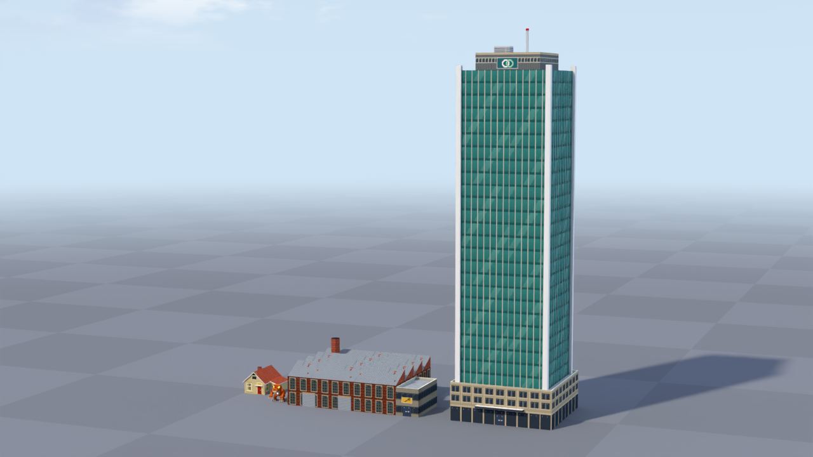
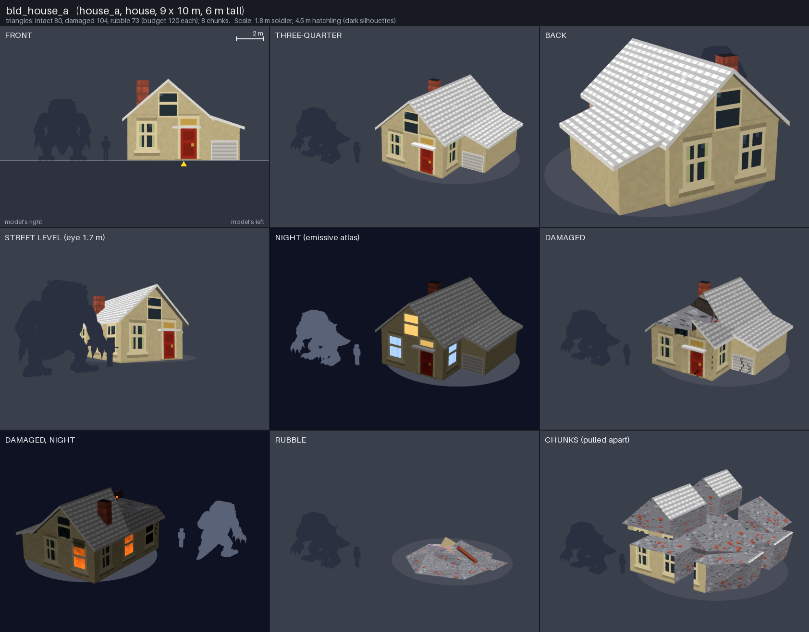

# Port Meridian buildings: the look

How a building in this game is put together, so that 40 building types made by six people
read as one city. The kit that does it is `tools/art/city/` (how to use it:
`tools/art/city/README.md`). Pictures: the three proof buildings below, the atlas in
`docs/art/previews/city_kit_atlas.png`, and the buildings in the running game in
`docs/art/previews/city_kit_in_game.png`.

## 1. What a building is

A painted plaster model: a few big, clean boxes and slopes, flat-shaded, hard edges, with all the
small detail (windows, doors, bricks, roof tiles, signs) painted into one shared picture, the
**city atlas**, at one fixed pixel size. Geometry is only for what changes the silhouette:
the body, the roof, chimneys, a parapet, balconies, awnings, signs that stick out, tanks, masts.
Nothing is modeled that a texture can say. A building is built in this order:

1. **Body**: one or more boxes (`block`), walls in bands: an optional ground storey, then upper
   storeys. Walls stretch a little so they always hold whole bays and whole storeys: a window is
   never cut by a corner.
2. **Roof**: gable, hip, mono-pitch (shed), sawtooth, flat with parapet, dome, cone or spire.
   Pitched roofs overhang by 0.375 m and get white verge and fascia boards.
3. **Street layer**: door bays, shopfronts, awnings, picture signs, canopies.
4. **Roof layer**: plant rooms, water tanks, vents, chimneys, masts with a red beacon.

Everything uses **one material** (`city_atlas`): faces without a picture map onto the atlas's
white swatch and take their color from the vertex color. One material means one draw call per
building type and state (section 5).

## 2. Sizes (the scale contract)

One atlas pixel on a wall or roof is **0.1875 m**; 16 pixels are 3 m. Next to the 1.8 m soldier,
the 4.5 m hatchling and the 115 m titan these sizes are the same on every building:

| Thing | Size | Pixels |
| --- | --- | --- |
| Storey, floor to floor (homes, upper floors) | 3.0 m | 16 |
| Ground storey of shops, blocks, offices | 4.5 m | 24 |
| Bay (one window per bay) | 3.0 m | 16 |
| Ordinary window | 1.5 x 1.875 m, sill 0.75 m above the floor | 8 x 10 |
| House door (with frame) | 1.125 x 2.25 m, shown as a whole "door bay" | 6 x 12 in a 16 x 16 bay |
| Shop and lobby double door | 2.25 x 2.625 m | 12 x 14 |
| Garage door / loading door | 3 x 2.25 m / 3.75 x 3.75 m | 16 x 12 / 20 x 20 |
| Sign band over a shopfront | 1.125 m | 6 |
| Parapet / cornice / eave overhang | 0.75 m / 0.375 m / 0.375 m | |
| Balcony depth, railing height | 1.2 m, 1.0 m | |

Houses are short in this city (house_a is 6 m to the ridge), so a two-storey house has its upper
storey **in the roof**: one 3.4 m storey of windows, then a gable with an attic window. Leftover
height in tall buildings goes into the ground storey, a podium, a parapet or a crown, never into
taller windows. Footprint and height come from `tools/art/data/archetypes.json` and the whole
intact model, overhangs and masts included, must fill that box within max(0.25 m, 2%) on every
side (the simulation collides with the box); the kit refuses a building that does not.

## 3. How districts differ at a glance

| District | Walls (atlas) | Wall colors (tint) | Roof shapes (the color is the district's) | Signs and accents |
| --- | --- | --- | --- | --- |
| Suburbs | plaster sash, clapboard | cream, salmon, sky, mint, peach, lime, white, lilac | tile gables and hips | red, blue, green doors; corner-shop pictures |
| Old Town | plaster sash, brick sash, shopfronts | ochre, sand, salmon, cream, mustard | tile, steep; chimneys | blade signs, striped awnings |
| Temple Hill | plaster, arcade | white, rose, cream, peach | round tiles, tiered and turned up | no symbols; terracotta and gold trim |
| Downtown | glass (teal, dark, blue), stone grid, lobby, plinth | stone, slate, white, concrete | flat, plant rooms, masts with beacons | abstract crown marks (rings, chevron) |
| University | brick sash, stone grid | stone, sand | slate | none |
| Cinder Works, Docks | works brick, metal cladding, loading | concrete, slate, sand, mustard | sawtooth, corrugated metal, tanks | gold and rust; roller doors |
| Boardwalk | plaster, clapboard, glass rail | white, seafoam, peach, sky, rose | slate, canvas | candy-striped awnings |

The wall color is a **tint**: walls on tintable regions carry a mask (vertex color alpha 1) and
the manifest lists the district's colors, so one model can be painted many ways. The client
applies it: each copy takes one of the colors, times its district's building tint
(`docs/CITY.md` section 2).

The roof color is the **district's** (roadmap phase 3): every ordinary building draws its roof
faces in light neutral grey, with the tile, slate or seam pattern kept as lighter and darker
lines, and marks them (vertex color alpha 0.5); the game paints them in the district's roof
color, a few shades apart from building to building, so each district, and each starting
neighborhood, reads as its own place from the monster's height: terracotta on Temple Hill,
slate blue in Bellhaven, moss green in Hollowmere, charcoal in Northgate, soot in the Cinder
Works (`District.roof` in the city data). The table above gives the roof shapes. Landmarks,
bridges and the special buildings keep their own roof colors, as do glass, copper and canvas
roofs. How it is made: `tools/art/city/README.md` section 2a. Pictures:
`docs/art/previews/city_roofs_districts.png` and the check sheet `city_roofs_test.png`.

Signs are pictures only (a cup, a loaf, a fish, scissors, a key, glasses...), never words, and
never a cross (not even a pharmacy's: the pharmacy sign is a pill) or any religious symbol.

## 4. Night and the three states

**Night**: the emissive atlas has the same layout. Homes light about half their windows warm
yellow; offices and towers light about half cool white; shops nearly all; signs glow in neon
along their picture; mast beacons are red. Nothing else glows.

**Intact**: as built. **Damaged** (made by the kit, never by hand): the same silhouette with a
missing top corner on the street side and one to three holes through the walls, broken-open
floors inside the holes (with embers at night), walls swapped to their wrecked twins (60% of the
glass broken, soot plumes above the holes, cracks; at night a few holes glow with fire), faces
near the holes scorched. A hole cuts what it reaches and nothing else: balconies, doors, signs
and other small parts are cut at its edge, not taken away whole, so the damaged building still
reads as the same building (a part loses everything only when the hole takes more than half of
it, or when the triangle budget leaves no other way). Wherever a hole lets a player see the back
of something (the underside of a cut roof, the inside of a canopy, a broken-open floor seen from
under the eaves) the kit adds a back side in a dark inside color, measured by looking from every
side; nothing shows magenta on the sheets. **Rubble**: a low grey heap inside the footprint (8%
of the height plus 0.8 m, at most 9 m and at most a third of the building), rough mounds, bent
rusty beams and two to four slabs of the building's own facade lying on top, plus an optional
keepsake (a landmark's recognizable piece). The keepsake may stand above the heap: the whole
ruin, keepsake included, stays inside the footprint and **at most 35% of the building's height**
(the city check enforces this). A ruin players can recognize tells them where they are, so four
landmarks use that room: Kiln Point Power Station (its two chimney stumps, 27 m), the Tidewheel
(a piece of its rim, 22 m), Tidewater Cathedral (the round window frame, 19 m) and the Gasworks
(a bent gasholder frame, 15 m). **Chunks**: 6 to 24 pieces cut from the building's solids on a jittered
grid (8 for small, 12 for medium, 18 for large, 20 for landmarks), each textured from the wall
it came from, broken faces in rubble, origin at its own center, at most 30 triangles.

## 5. Budgets (triangles per state)

From the real city (`npx tsx tools/art/city/count_city.ts`: 3185 structures, counted again
after phase 3 packed the starting neighborhoods). Every archetype gets its class ceiling from
`docs/ASSETS.md` except a few simple shapes. The sum of count x budget is **502,290 triangles**
for the whole intact city, a little over half of the 900,000 cap, and only the camera's
surroundings are ever on screen.

| Archetypes | Count | Budget | Triangles |
| --- | --- | --- | --- |
| house_a 283, house_b 209, house_c 400, rowhouse_a 286 | 1178 | 120 | 141,360 |
| bungalow_a 314, duplex_a 158, garage_a 232 (phase 3) | 704 | 120 | 84,480 |
| shop_a 114, shop_b 184, shop_c 126, pavilion_a 17, shrine_a 77 | 518 | 120 | 62,160 |
| diner_a 10, firehouse_a 10, motel_a 10 (phase 3) | 30 | 120 | 3,600 |
| apartment_a 149, apartment_b 90, apartment_c 62, office_a 50, office_b 34, campus_a 34 | 419 | 250 | 104,750 |
| office_c 28, tower_a 21, tower_b 12, tower_c 12 | 73 | 500 | 36,500 |
| factory_a 40, factory_b 7, crane_a 15, bridge_a 5 | 67 | 250 | 16,750 |
| warehouse_a 24 / tank_a 26 / container_a 58 | 108 | 220 / 200 / 120 | 17,440 |
| substation_a 24 / gasstation_a 25 / radiomast_a 25 (the special buildings) | 74 | 250 / 250 / 120 | 15,250 |
| bridge_b 1 | 1 | 500 | 500 |
| the 13 landmarks, one each | 13 | 1500 | 19,500 |

The total rose from 440,920 at the last count (2695 structures): the packed starting
neighborhoods hold about 540 more buildings, and the 74 special buildings are counted now. The
six new kinds' whole models are 40 to 84 triangles, well under their budget of 120.

**Draw calls**: the client draws one instanced batch per building type, per state and per
material, and only batches that have buildings in them. With one material that is at most
49 x 3 = 147 calls for every building in the city, plus one for all falling chunks: well inside
the 350 budget (measured in phase 3 with everything on screen included: 120 to 135 calls; see
`docs/CITY.md` section 8). A second
material (for example `glow` for a beacon) would double a building's calls: use the atlas's
glowing swatches (`lamp`, `beacon`, `neon_pink`, `neon_mint`, `lit_glass`) instead.

| Proof building | Intact | Damaged | Rubble | Chunks | Budget |
| --- | --- | --- | --- | --- | --- |
| bld_house_a | 80 | 104 | 73 | 8 | 120 |
| bld_tower_a | 320 | 464 | 137 | 24 | 500 |
| bld_factory_a | 164 | 216 | 121 | 8 | 250 |
