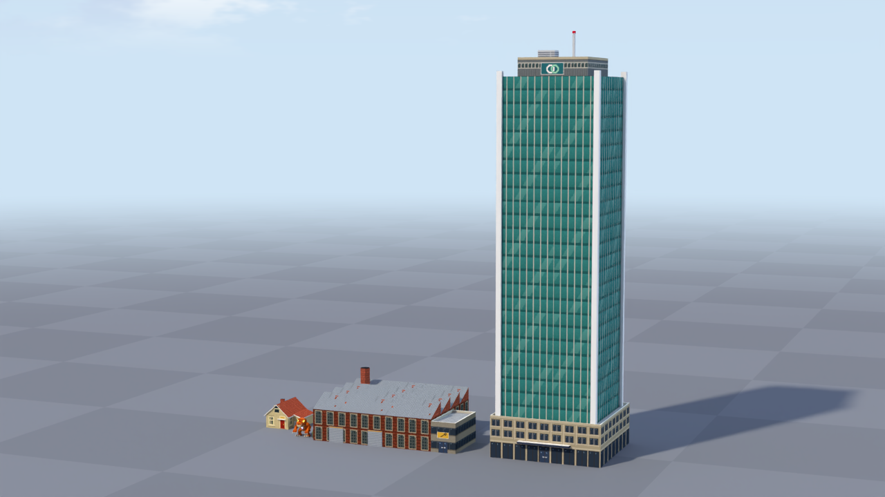
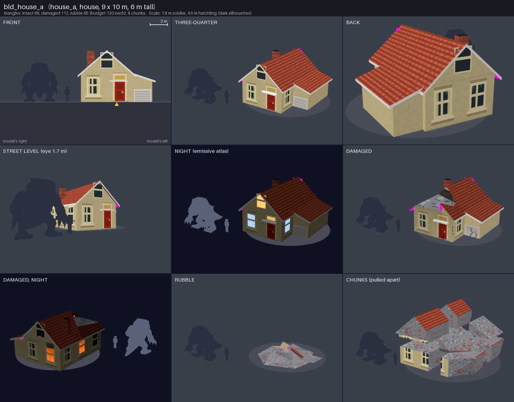

# Port Meridian buildings: the look

How a building in this game is put together, so that 40 building types made by six people
read as one city. The kit that does it is `tools/art/city/` (how to use it:
`tools/art/city/README.md`). Pictures: the three proof buildings below, the atlas in
`docs/art/previews/city_kit_atlas.png`, and the buildings in the running game in
`docs/art/previews/city_kit_in_game.png`.

## 1. What a building is

A painted plaster model: a few big, clean boxes and slopes, flat-shaded, hard edges, with all the
small detail (windows, doors, bricks, roof tiles, signs) painted into one shared picture, the
**city atlas**, at one fixed pixel size. Geometry is only for what changes the silhouette:
the body, the roof, chimneys, a parapet, balconies, awnings, signs that stick out, tanks, masts.
Nothing is modeled that a texture can say. A building is built in this order:

1. **Body**: one or more boxes (`block`), walls in bands: an optional ground storey, then upper
   storeys. Walls stretch a little so they always hold whole bays and whole storeys: a window is
   never cut by a corner.
2. **Roof**: gable, hip, mono-pitch (shed), sawtooth, flat with parapet, dome, cone or spire.
   Pitched roofs overhang by 0.375 m and get white verge and fascia boards.
3. **Street layer**: door bays, shopfronts, awnings, picture signs, canopies.
4. **Roof layer**: plant rooms, water tanks, vents, chimneys, masts with a red beacon.

Everything uses **one material** (`city_atlas`): faces without a picture map onto the atlas's
white swatch and take their color from the vertex color. One material means one draw call per
building type and state (section 5).

## 2. Sizes (the scale contract)

One atlas pixel on a wall or roof is **0.1875 m**; 16 pixels are 3 m. Next to the 1.8 m soldier,
the 4.5 m hatchling and the 115 m titan these sizes are the same on every building:

| Thing | Size | Pixels |
| --- | --- | --- |
| Storey, floor to floor (homes, upper floors) | 3.0 m | 16 |
| Ground storey of shops, blocks, offices | 4.5 m | 24 |
| Bay (one window per bay) | 3.0 m | 16 |
| Ordinary window | 1.5 x 1.875 m, sill 0.75 m above the floor | 8 x 10 |
| House door (with frame) | 1.125 x 2.25 m, shown as a whole "door bay" | 6 x 12 in a 16 x 16 bay |
| Shop and lobby double door | 2.25 x 2.625 m | 12 x 14 |
| Garage door / loading door | 3 x 2.25 m / 3.75 x 3.75 m | 16 x 12 / 20 x 20 |
| Sign band over a shopfront | 1.125 m | 6 |
| Parapet / cornice / eave overhang | 0.75 m / 0.375 m / 0.375 m | |
| Balcony depth, railing height | 1.2 m, 1.0 m | |

Houses are short in this city (house_a is 6 m to the ridge), so a two-storey house has its upper
storey **in the roof**: one 3.4 m storey of windows, then a gable with an attic window. Leftover
height in tall buildings goes into the ground storey, a podium, a parapet or a crown, never into
taller windows. Footprint and height come from `tools/art/data/archetypes.json` and the whole
intact model, overhangs and masts included, must fill that box within max(0.25 m, 2%) on every
side (the simulation collides with the box); the kit refuses a building that does not.

## 3. How districts differ at a glance

| District | Walls (atlas) | Wall colors (tint) | Roofs | Signs and accents |
| --- | --- | --- | --- | --- |
| Suburbs | plaster sash, clapboard | cream, salmon, sky, mint, peach, lime, white, lilac | red tile gables and hips | red, blue, green doors; corner-shop pictures |
| Old Town | plaster sash, brick sash, shopfronts | ochre, sand, salmon, cream, mustard | red tile, steep; chimneys | blade signs, striped awnings |
| Temple Hill | plaster, arcade | white, rose, cream, peach | terracotta, tiered and turned up | no symbols; terracotta and gold trim |
| Downtown | glass (teal, dark, blue), stone grid, lobby, plinth | stone, slate, white, concrete | flat, plant rooms, masts with beacons | abstract crown marks (rings, chevron) |
| University | brick sash, stone grid | stone, sand | slate | none |
| Cinder Works, Docks | works brick, metal cladding, loading | concrete, slate, sand, mustard | sawtooth, corrugated metal, tanks | gold and rust; roller doors |
| Boardwalk | plaster, clapboard, glass rail | white, seafoam, peach, sky, rose | slate, canvas | candy-striped awnings |

The wall color is a **tint**: walls on tintable regions carry a mask (vertex color alpha 1) and
the manifest lists the district's colors, so one model can be painted many ways. The client
applies it: each copy takes one of the colors, times its district's building tint
(`docs/CITY.md` section 2).
Signs are pictures only (a cup, a loaf, a fish, scissors, a key, glasses...), never words, and
never a cross (not even a pharmacy's: the pharmacy sign is a pill) or any religious symbol.

## 4. Night and the three states

**Night**: the emissive atlas has the same layout. Homes light about half their windows warm
yellow; offices and towers light about half cool white; shops nearly all; signs glow in neon
along their picture; mast beacons are red. Nothing else glows.

**Intact**: as built. **Damaged** (made by the kit, never by hand): the same silhouette with a
missing top corner on the street side and one to three holes through the walls, broken-open
floors inside the holes (with embers at night), walls swapped to their wrecked twins (60% of the
glass broken, soot plumes above the holes, cracks; at night a few holes glow with fire), faces
near the holes scorched. **Rubble**: a low grey heap inside the footprint (8% of the height plus
0.8 m, at most 9 m and at most a third of the building), rough mounds, bent rusty beams and two
to four slabs of the building's own facade lying on top, plus an optional keepsake (a landmark's
recognizable piece). **Chunks**: 6 to 24 pieces cut from the building's solids on a jittered
grid (8 for small, 12 for medium, 18 for large, 20 for landmarks), each textured from the wall
it came from, broken faces in rubble, origin at its own center, at most 30 triangles.

## 5. Budgets (triangles per state)

From the real city (`npx tsx tools/art/city/count_city.ts`: 2695 structures). Every archetype
gets its class ceiling from `docs/ASSETS.md` except a few simple shapes. The sum of count x
budget is **440,920 triangles** for the whole intact city, half of the 900,000 cap, and only
the camera's surroundings are ever on screen.

| Archetypes | Count | Budget | Triangles |
| --- | --- | --- | --- |
| house_a 333, house_b 299, house_c 441, rowhouse_a 359 | 1432 | 120 | 171,840 |
| shop_a 132, shop_b 189, shop_c 135, pavilion_a 24, shrine_a 72 | 552 | 120 | 66,240 |
| apartment_a 159, apartment_b 97, apartment_c 62, office_a 51, office_b 35, campus_a 38 | 442 | 250 | 110,500 |
| office_c 28, tower_a 21, tower_b 12, tower_c 12 | 73 | 500 | 36,500 |
| factory_a 45, factory_b 7, crane_a 15, bridge_a 5 | 72 | 250 | 18,000 |
| warehouse_a 24 / tank_a 28 / container_a 58 | 110 | 220 / 200 / 120 | 17,840 |
| bridge_b 1 | 1 | 500 | 500 |
| the 13 landmarks, one each | 13 | 1500 | 19,500 |

**Draw calls**: the client draws one instanced batch per building type, per state and per
material, and only batches that have buildings in them. With one material that is at most
40 x 3 = 120 calls for every building in the city, plus one for all falling chunks: well inside
the 350 budget (measured in the sandbox at night, everything included: 79 to 96 calls). A second
material (for example `glow` for a beacon) would double a building's calls: use the atlas's
glowing swatches (`lamp`, `beacon`, `neon_pink`, `neon_mint`, `lit_glass`) instead.

| Proof building | Intact | Damaged | Rubble | Chunks | Budget |
| --- | --- | --- | --- | --- | --- |
| bld_house_a | 80 | 100 | 65 | 8 | 120 |
| bld_tower_a | 320 | 447 | 111 | 24 | 500 |
| bld_factory_a | 164 | 206 | 119 | 8 | 250 |
